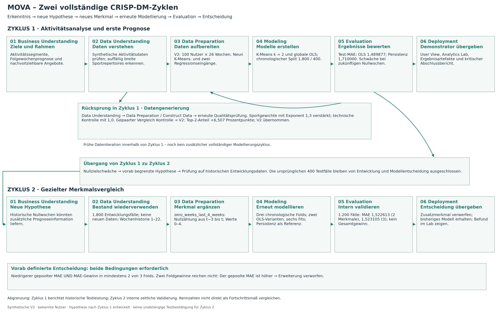
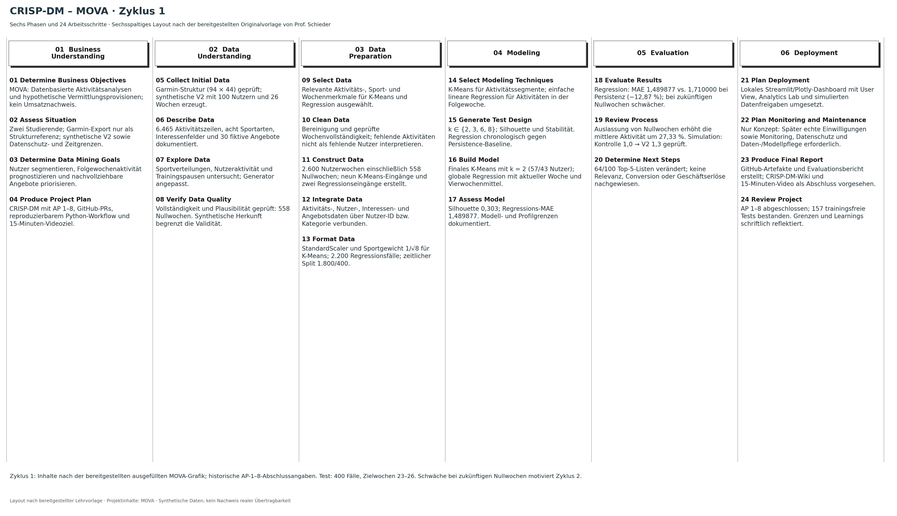
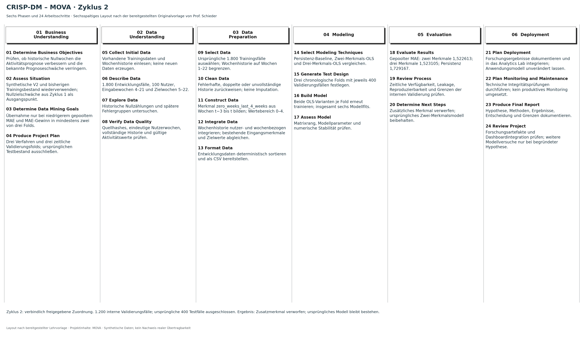

# MOVA – Move beyond: Wissenschaftliches Lab-Log

**Neue quellenbasierte Rekonstruktion, Stand 04.11.2026.** Diese Fassung ist keine originalgetreue Wiederherstellung früherer verlorener Dokumente. Sie wurde anhand des vorhandenen Repositorys und der ausdrücklich bereitgestellten Teamangaben neu verfasst. Referenzstand: `7282cef20cdcc871ff78b2c9e879b98cd880f4f5`, Branch `feature/final-lab-log`. Die Rekonstruktion und die bisherigen Ergänzungen wurden inzwischen versioniert; der gesicherte Ausgangsstand dieser redaktionellen Ergänzung ist `5215e5e209c6e612ff054136ad35c9fa397ab104`. Die hier ergänzten persönlichen Angaben sind zunächst uncommittet. Die Originalunterlagen nennen Big Data Analytics, Master Digital Business, OTH Amberg-Weiden. Matrikelnummern, Prüfungstermin und vollständige Autorinnennamen sind noch zu ergänzen. Autorinnen nach Teamangabe: **Hanna und Patricia**.

Der Haupttext folgt dem realen Projektverlauf vom 29.10. bis zum 04.11.2026. Projektwochen innerhalb der synthetischen Daten sind davon zu unterscheiden: Sie reichen vom 05.01. bis zum 05.07.2026. Die im Verlauf bereitgestellten Originalunterlagen „Rahmen und Ablauf der Leistungsnachweise – Big Data Analytics“ (nur LN B und die dafür geltenden gemeinsamen Regeln) sowie „Bewertungsbogen LN B – Datenanalyseprojekt“ bilden die verbindliche Prüfgrundlage. Der systematische Abgleich ist im Qualitätscheck dokumentiert. Eine vollständige Erfüllung einschließlich Vortrag und Abgabe wird für diesen Markdown-Entwurf nicht behauptet. Eine aussagenbezogene [Nachweismatrix](final_lab_log_evidence.md), [offene Punkte](final_lab_log_open_items.md), ein [Qualitätscheck](final_lab_log_quality_check.md) und das [KI-Irrwege-Audit](ai_missteps_audit.md) ergänzen den Text.

## 1. Projektbeginn: Problemstellung, Zusammenarbeit und wissenschaftlicher Rahmen

### 1.1 Ziel und Gegenstand des Hochschulprojekts

MOVA untersucht, wie Aktivitätsdaten für verständliche Analysen und eine nachvollziehbare Vorauswahl von Freizeit-, Sport-, Outdoor- und Wellnessangeboten genutzt werden können. Die Ausgangsidee verbindet eine Personal-Advisor-Oberfläche mit einer hypothetischen Vermittlungslogik. Nutzerinnen und Nutzer sollen ihre Aktivitätsmuster verstehen und passende Angebote leichter finden können. Für Anbieter wäre eine zielgerichtete Vermittlung möglicherweise wirtschaftlich interessant. Diese Wirkungskette beschreibt eine Geschäftsannahme und keinen gemessenen Nutzen. Das Repository enthält weder reale Buchungen noch Provisionserlöse oder einen validierten Umsatzmechanismus. Deshalb wird die wirtschaftliche Vision von der tatsächlich implementierten analytischen Funktion getrennt [E01, E25].

Die technische Forschungsaufgabe wurde in drei miteinander verbundene Teile übersetzt. Erstens sollten ähnliche Aktivitätsprofile deskriptiv gruppiert werden. Zweitens sollte ein globales Regressionsmodell die Anzahl der Aktivitäten in der nächsten Woche prognostizieren. Drittens sollte ein regelbasiertes Empfehlungssystem aus einem fiktiven Angebotskatalog nachvollziehbare Listen erzeugen. Die Modellierung beantwortet damit andere Fragen als die Empfehlungslogik: Segmente und Prognosen liefern Kontext, während die Angebotsreihenfolge durch dokumentierte Regeln entsteht. Eine datengetriebene Empfehlung mit gelerntem Relevanzziel wurde nicht umgesetzt.

Der Einsatz synthetischer Daten ermöglichte eine kontrollierbare Projektumgebung mit offengelegten Annahmen. Zugleich begrenzt er die Aussagekraft: Nachgewiesen werden können interne Konsistenz, das Verhalten ausgewählter Algorithmen und die technische Funktionsfähigkeit. Repräsentativität für reale Smartwatch-Nutzer, medizinische Aussagen oder eine Verbesserung des Wohlbefindens lassen sich daraus nicht ableiten. Der Begriff Big Data Analytics bezeichnet hier den Modulkontext; 6.465 Aktivitäten sind kein Nachweis einer technisch großskaligen Datenverarbeitung. Verteilte Infrastruktur oder ein empirischer Skalierungstest waren nicht Gegenstand der Umsetzung.

### 1.2 Gemeinsame Teamarbeit und Verantwortung

**Persönliche Bestätigung beider Teammitglieder:** Hanna und Patricia erarbeiteten sämtliche fachlichen und technischen Projektbestandteile gemeinsam: Konzeption, Datenaufbereitung, Modellierung, Evaluation, Programmierung, KI-Überprüfung und Dokumentation. Die Zusammenarbeit erfolgte regelmäßig in Videokonferenzen mit geteilten Bildschirmen sowie durch gemeinsame Nutzung von ChatGPT, Codex und GitHub. Es gab keine klassische Aufgabenaufteilung und keine getrennten fachlichen Zuständigkeiten für einzelne CRISP-DM-Phasen. Beide starteten nach eigener Angabe mit vergleichbarem, noch begrenztem praktischem Vorwissen. Die gemeinsame Arbeitsweise wurde bewusst gewählt, damit beide den vollständigen Prozess verstehen und ihre Kompetenzen über alle Phasen hinweg aufbauen konnten [E02].

**Organisatorische Ausnahme: Videoproduktion.** Inhaltliche Ausarbeitung, Sprachgenerierung sowie abschließende Prüfung und Freigabe des Videos erfolgten gemeinsam. Lediglich einzelne Produktionsarbeiten wurden aufgeteilt [E51]:

| Beteiligung | Bestätigte Aufgaben in der Videoproduktion |
| --- | --- |
| Hanna und Patricia gemeinsam | Inhaltliche Ausarbeitung, Sprachgenerierung, abschließende Prüfung und Freigabe |
| Hanna | Überarbeitung der PowerPoint-Folien, Bildschirmaufnahmen und Abfilmen der Präsentation |
| Patricia | Weiterer Videoschnitt und Soundbearbeitung |

Diese organisatorische Ausnahme begründet keine nachträgliche Aufteilung der wissenschaftlichen Projektarbeit. Aus Produktionsaufgaben lassen sich weder feste Methodenverantwortlichkeiten noch tatsächliche Redeanteile oder bereits nachgewiesene Live-Kompetenz ableiten. Die Angaben werden als persönliche Bestätigung dokumentiert; eine neue Prüfung von Video- oder PowerPoint-Dateien ist damit nicht verbunden.

Die gemeinsame Bearbeitung erklärt auch die Entscheidungslogik des Projekts. KI-generierte Vorschläge wurden nicht allein durch ihre technische Umsetzbarkeit akzeptiert, sondern auf fachlichen Zweck, zeitliche Verfügbarkeit der Informationen und Aussagekraft der Evaluation geprüft. Repositorydateien belegen die Ergebnisse solcher Entscheidungen; sie belegen nicht automatisch den Verlauf jeder gemeinsamen Besprechung. Die Teamdarstellung ist deshalb als Selbstauskunft ausgewiesen. Gesprächsdaten, Stundenaufstellungen oder individuelle Beiträge werden nicht erfunden.

### 1.3 Zwei vollständige Zyklen statt bloßer Wiederholungen

CRISP-DM strukturiert das Projekt in Business Understanding, Data Understanding, Data Preparation, Modeling, Evaluation und Deployment. Im ersten Zyklus wurde die vollständige Kette von der Geschäftsfrage bis zum lokalen Demonstrator durchlaufen. Ein früher Rücksprung veränderte die synthetische Datengenerierung. Diese Dateniteration gehört zum ersten Zyklus; sie wird nicht allein deshalb als zweiter vollständiger Modellierungszyklus gezählt. Erst die erneute, hypothesengeleitete Regressionsmodellierung mit eigener zeitlicher Evaluation bildet Zyklus 2 [E03, E31].



*Abbildung 1: Iterativer Gesamtprozess. Die historische Testleistung aus Zyklus 1 und die interne Validierung aus Zyklus 2 sind unterschiedliche Untersuchungen. Eigene Projektgrafik; die Dateniteration ist im CRISP-DM-Protokoll belegt.*

## 2. Zyklus 1 – Business Understanding: vom Anwendungsgedanken zum Prüfplan

**Themenfindung und fachliche Abstimmung:** Nach persönlicher Bestätigung von Hanna und Patricia wurde die MOVA-Idee im Rahmen mehrerer Vorlesungstermine in Abstimmung mit **Prof. Dr. Schieder** entwickelt und konkretisiert. Dabei wurden unterschiedliche Geschäftsideen und Möglichkeiten datenbasierter Wertschöpfung diskutiert. Der schließlich gewählte MOVA-Ansatz wurde von Prof. Schieder als geeignet und im Projektrahmen grundsätzlich machbar eingestuft. Die Themenwahl erfolgte somit nicht ohne vorausgehenden fachlichen Austausch. Diese Einschätzung betrifft die Eignung der Projektidee, nicht einen empirischen Nachweis von Geschäftswirkung oder Modellgüte. Sie wird als fachliche Abstimmung im Business Understanding und als persönliche Teamangabe dokumentiert; eine gesonderte formale Vorabanmeldung wird mangels entsprechendem Nachweis nicht behauptet. Konkrete Sitzungstermine oder andere diskutierte Ideen werden nicht erfunden [E50].

Am 29.10.2026 wurde die Projektstruktur angelegt. Die spätere Git-Historie dokumentiert getrennte Arbeitspakete für Simulation, Datenverständnis, Aufbereitung, Modellierung, Empfehlungen, Dashboard und Abschlussbewertung. GitHub diente der Versionierung und Integration. Ein Commitzeitpunkt belegt die Versionierung, nicht notwendigerweise Beginn oder Dauer der dazugehörigen Tätigkeit. Für den fachlichen Verlauf werden deshalb zusätzlich die datierten Ausführungsberichte verwendet [E04].

**Zeitliche Einordnung nach persönlicher Bestätigung von Hanna und Patricia:** Zu Projektbeginn wussten beide noch nicht, dass die konkrete Festlegung von Erfolgskriterien später ausdrücklich Teil der Projektbewertung sein würde. Ihr Schwerpunkt lag zunächst auf einer geeigneten Geschäftsidee, dem Verständnis der Analysemethoden und einem funktionsfähigen Demonstrator. Es wurden daher anfangs keine quantitativen Akzeptanzschwellen festgelegt. Silhouette, MAE und RMSE wurden im fachlichen Projektverlauf als geeignete Bewertungsmaße eingesetzt. Die übergreifende Erfolgskriterientabelle in §15.1 entstand erst bei der abschließenden wissenschaftlichen Reflexion und wird nicht als ursprünglicher Projektplan dargestellt. Davon zu unterscheiden ist die vor dem zweiten Regressionsvergleich gemeinsam übernommene Entscheidungsregel aus §9 [E48, E49].

Das zentrale Problem bestand darin, aus heterogenen Aktivitätsbeobachtungen ein verständliches Nutzerbild zu entwickeln, ohne Cluster mit Fitnessklassen oder Häufigkeiten mit Präferenzen zu verwechseln. Als methodische Startpunkte wurden K-Means und eine einfache globale lineare Regression gewählt. K-Means erlaubt eine nachvollziehbare Gruppierung anhand ähnlicher Merkmalsvektoren. OLS ermöglicht eine direkt erklärbare gewichtete Summe weniger historischer Eingänge. Die Auswahl ist als begrenzter Einstieg begründet, nicht als Nachweis einer optimalen Modellfamilie. Weitere komplexe Modellfamilien wurden in diesem Projekt nicht systematisch getestet.

Für das Prognoseziel wurde die Anzahl aller aufgezeichneten Aktivitäten der nächsten vollständigen Woche festgelegt. Dadurch entstand eine klar messbare Zielvariable. Die Persistenzregel, die aktuelle Wochenaktivität unverändert fortzuschreiben, wurde als einfache Referenz aufgenommen. Das Projekt sollte somit nicht nur ein Modell bereitstellen, sondern prüfen, ob dieses eine bekannte, datenarme Alternative übertrifft. Für das Clustering fehlen externe Klassenlabels; dort mussten interne Strukturkennzahlen und Stabilität herangezogen werden.

Die fachliche Abgrenzung beeinflusste den Entwicklungsplan. Die Analyse blieb sportartenübergreifend, die Regression global für alle bekannten Nutzer und die Empfehlung regelbasiert. Dadurch wurden Einzelfallmodelle, medizinische Diagnosen und eine scheinbar personalisierte Kaufwahrscheinlichkeit vermieden. Eine spätere Erweiterung durfte nicht allein aus einer interessanten Visualisierung abgeleitet werden, sondern benötigte eine explizite Hypothese und ein geeignetes Validierungsdesign. Diese Forderung wurde im zweiten Zyklus konkret umgesetzt.

## 3. Zyklus 1 – Data Understanding: Simulation, Qualitätsbefunde und erster Rücksprung

### 3.1 Datenherkunft und Annahmen

**Persönliche Bestätigung beider Teammitglieder:** Hanna und Patricia bestätigen, dass der ursprüngliche reale Garmin-Export **94 Zeilen und 44 Spalten** umfasste und ausschließlich als strukturelle Orientierung diente, um die von Garmin bereitgestellten Datenfelder zu verstehen. Weder konkrete Werte noch Verteilungen oder personenbezogene Aktivitätsdaten wurden daraus für die synthetische Datengenerierung übernommen. Die synthetischen MOVA-Daten wurden unabhängig von diesen empirischen Exportinhalten erzeugt; es erfolgte **keine empirische Kalibrierung anhand des Exports**. Die Einsicht in dessen Feldstruktur begründet weder Repräsentativität noch reale Validität. **Keine echten Garmin-Nutzerdaten gingen in das Modelltraining ein; eine produktive Garmin-Anbindung wurde nicht umgesetzt.** Der tatsächliche Umgang mit dem persönlichen Export ist als Bestätigung von Hanna und Patricia gekennzeichnet, nicht als neu durchgeführte Prüfung der privaten Exportdatei. Die vorhandenen Konzepte und der Generator dokumentieren die Strukturreferenz und die synthetische Verarbeitung [E47].

Die aktive synthetische V2 umfasst 100 Nutzer, 26 vollständige Montag-bis-Sonntag-Wochen, 6.465 Aktivitäten, acht Sportarten und 30 fiktive Angebote. Interessen werden als synthetische Booleanwerte geführt. Aktivitäts-IDs, Nutzer-IDs, Datumsfelder und Sportarten ermöglichen die Zuordnung; Dauer und teilweise Distanz beschreiben Aktivitäten. Diese Feldrollen sind im Datenwörterbuch und in den Qualitätsberichten dokumentiert [E05, E06].

Zur Simulation gehören Annahmen über individuelle Häufigkeiten, Trends, Pausen und Sportverteilungen. Der Master-Seed beträgt 42; in V2 werden getrennte Zufallsquellen 42–49 verwendet. Damit wird eine Wiederholung des festgelegten Generierungsprozesses unterstützt. Ein fixer Seed erzeugt allerdings keine empirische Validität. Er hält eine konstruierte Welt konstant, deren Verteilungen außerhalb der Simulation erst zu prüfen wären. Interessen im Katalogkontext sind ebenfalls generiert und keine tatsächlich erhobenen Kaufabsichten.

Eine wesentliche Qualitätsfrage betrifft die 558 Nullwochen im vollständigen Raster von 2.600 Nutzerwochen. In der Simulation können diese als Wochen ohne aufgezeichnete Aktivitäten gezählt werden. Für reale Wearables müsste zusätzlich geklärt werden, ob Nichttragen, fehlende Synchronisation oder technische Ausfälle vorliegen. Eine Null im Projekt ist deshalb kein allgemeiner Beweis tatsächlicher Inaktivität. Bei Distanzen gilt eine andere Semantik: 1.698 Leerwerte sind für Strength, Tennis und Padel strukturell nicht anwendbar. Sie durch null Kilometer zu ersetzen, würde eine falsche Messinformation erzeugen [E07].

### 3.2 Beobachtetes Problem und Generierungsiteration

Die erste Simulation V1 zeigte trotz vorhandener persönlicher Schwerpunkte sehr breite Sportrepertoires: 59 Nutzer hatten alle acht Sportarten, die mittlere Sportartenanzahl betrug 7,47. Das Team wollte individuelle Schwerpunkte deutlicher abbilden, ohne feste Sportartenlimits oder gewünschte Clusterlabels zu erzwingen. Als gezielte Änderung wurden die positiven individuellen Sportgewichte mit Exponent 1,3 verstärkt. Der fachliche Rücksprung führte von Data Understanding zu Construct Data und anschließend erneut zur Qualitätsprüfung [E08].

Die Umsetzung brachte eine methodische Schwierigkeit mit sich. Zugleich wurden die Zufallsquellen technisch getrennt. Ein direkter Vergleich von historischem V1 und V2 hätte daher zwei Änderungen vermischt: den Präferenzexponenten und den Zufallsstrom. Als Alternative zu einer voreiligen Wirkungsaussage wurde ein technischer Kontrolllauf mit Exponent 1,0 bei demselben neuen Zufallsaufbau verwendet. Erst Kontrolle 1,0 gegen V2 1,3 erlaubt die isolierte Bewertung der Präferenzverstärkung innerhalb dieses Simulationsdesigns.

Im gepaarten Vergleich stieg der mittlere Top-2-Sportanteil von 57,61 % auf 64,12 %, also um rund 6,507 Prozentpunkte. Die Zahl der Nutzer mit acht Sportarten sank von 58 auf 40; die mittlere Vielfalt von 7,32 auf 6,95. Die Wochenzählungen blieben in diesem Vergleich gleich. Historisch unterscheiden sich V1 und V2 dagegen auch bei Aktivitäten und Nullwochen: 6.665/545 gegenüber 6.465/558. Diese Häufigkeitsunterschiede dürfen nicht dem Exponenten zugeschrieben werden [E09].

Das Team übernahm V2 verbindlich und behielt historische V1-Artefakte getrennt. Die Entscheidung stützt eine gewünschte deskriptive Eigenschaft der Simulation, nicht bessere Prognose- oder Clusterqualität. Es wurde weder eine Realitätsvalidierung durchgeführt noch ein Zielwert der späteren Modellgüte optimiert. Der Lerngewinn der Iteration liegt besonders in der Kontrolle konkurrierender Ursachen. Der Fall bleibt eine methodische Kontrolle der Datengenerierung; eine Ursache durch KI wird daraus nicht abgeleitet.

## 4. Zyklus 1 – Data Preparation: unterschiedliche Modellfragen, getrennte Eingänge

### 4.1 Auswahl, Bereinigung und Wochenraster

Am 31.10.2026 wurde die Aufbereitung entlang separater Skripte umgesetzt. Die Auswahl bewahrte alle 6.465 gültigen Aktivitäten und entfernte lediglich die Distanzspalte aus der Arbeitsdatei für die gewählten Modelle. Bereinigung bedeutet hier vor allem Validierung von Pflichtfeldern, Identitäten, Kalenderwerten und Zahlenbereichen; es wurden nicht pauschal ungewöhnliche, aber gültige Aktivitäten entfernt. Die Entscheidung schützt vor einer unbegründeten Veränderung des Datensatzes [E10].

Anschließend wurden Count und Dauer je Nutzer und Projektwoche aggregiert. Das vollständige Raster Nutzer × 26 Wochen enthält auch Wochen ohne Aktivitätszeilen. Diese erhalten Count und Dauer null, ohne neue Rohaktivitäten zu erzeugen. Das ist von fehlender Historie zu unterscheiden: Eine unbekannte Woche wird nicht durch einen erfundenen Nullwert ersetzt. Die separate Wochenkontrolle und das unabhängige Aufbereitungsaudit prüfen die Zuordnung gegen die Ausgangsdaten.

Der Nutzen dieser Entscheidung ist quantifizierbar. Mit allen Wochen ergeben sich 6.465/2.600 = 2,486538 Aktivitäten je Nutzerwoche. Werden Nullwochen ausgelassen, bleibt die Aktivitätssumme gleich, der Nenner sinkt auf 2.042 und der Mittelwert steigt auf 3,166014. Die relative Differenz beträgt 27,326151 %. Der höhere Wert bedeutet keine tatsächliche Aktivitätssteigerung. Er beschreibt nur aktive Wochen und wäre als Gesamthäufigkeit verzerrt. Dieser konkrete Nennerfehler wurde später als interaktives Lab-Experiment sichtbar gemacht [E11].

### 4.2 K-Means-Features und Gewichtung

Für das Clustering wurde die Beobachtungseinheit vom einzelnen Ereignis zum Nutzerprofil verändert. Die neun Modelleingänge bestehen aus mittleren Aktivitäten pro Woche und acht Sportartenanteilen. Wochenminuten und Sportvielfalt bleiben Interpretationsmerkmale. Die Nutzer-ID ist ein Schlüssel und kein numerischer Regressor oder Clusterindikator. Die Sportanteile beruhen auf beobachteten Counts und dürfen nicht mit subjektiver Präferenz oder Fitness gleichgesetzt werden [E12].

Die Standardisierung verhindert, dass unterschiedliche Skalen die euklidischen Distanzen unkontrolliert dominieren. Nach dem StandardScaler-Fit auf den 100 deskriptiven Profilen wurde jede Sportkoordinate zusätzlich mit 1/√8 gewichtet. Diese fachliche Startannahme gleicht die Summe der standardisierten Varianzen des Sportblocks näherungsweise an die eine Häufigkeitskoordinate an. Ohne diese Gewichtung könnte der aus acht Koordinaten bestehende Block unverhältnismäßig stark wirken. Eine empirisch optimale Gewichtung wurde nicht nachgewiesen; Anteile enthalten zudem nur sieben unabhängige Freiheitsgrade.

Die gespeicherten Skalierungsparameter und die skalierte Matrix erlauben eine Prüfung der Transformation ohne erneuten Fit. Eine zweite Standardisierung beim Modellieren wäre problematisch, weil sie die beabsichtigte Gewichtung aufheben könnte. Die Modellierung übernimmt deshalb die vorbereitete Matrix unverändert. Dieser Vertrag verbindet fachliche Entscheidung, technische Umsetzung und numerische Kontrolle.

### 4.3 Regressionsfenster, Zielvariable und Leakage

Für die Regression blieb die Beobachtungseinheit eine Nutzerwoche. Sei c(u,t) die Aktivitätszahl von Nutzer u in Woche t. Nach Abschluss von t werden c(u,t) und der Mittelwert aus t−3 bis t verwendet, um c(u,t+1) zu prognostizieren. Die ersten drei Eingabewochen liefern keine vollständige Vierwochenhistorie; Woche 26 hat kein beobachtetes Folgeziel. Daraus entstehen je Nutzer 22, insgesamt 2.200 Modellfälle. Historienwochen bleiben im Grundraster verfügbar, auch wenn sie selbst keine Modellzeile bilden [E13].

Die Konstruktion erfolgt chronologisch innerhalb jedes Nutzers. Ein gruppenbezogenes Zukunftslabel ist ausschließlich Zielvariable, nie Eingang. Tests verändern spätere Wochen und prüfen, ob frühere Eingänge unverändert bleiben. Ein Mittelwert über alle 26 Wochen oder die aus dem Gesamtzeitraum gebildeten K-Means-Cluster wäre für frühe Prognosen unzulässig. Dass diese Merkmale im Projekt vorhanden sind, macht sie nicht am jeweiligen Zeitpunkt verfügbar. Deshalb wurden Clusterlabels nicht in die Regression integriert.

Die Aufteilung verwendet Eingabewochen 4–21 als Training und 22–25 als Test. Zugehörige Ziele liegen in Wochen 5–22 beziehungsweise 23–26. Es entstehen 1.800 Trainings- und 400 Testfälle mit denselben 100 Nutzern. Die Alternative eines zufälligen Zeilensplits wurde zugunsten der zeitlichen Trennung ausgeschlossen: Sonst könnten spätere Nutzerwochen das Training früherer Prognosen beeinflussen. Das Design misst spätere Wochen bekannter Personen, nicht Generalisierung auf neue Nutzer [E14].

Das Protokoll ist eine rollierende Einwochenprognose mit festgehaltenem Modell. Nach Abschluss von Woche 23 darf deren beobachtete Aktivität als Eingang für Woche 24 dienen. Es handelt sich nicht um eine gleichzeitige Vierwochenprognose am Ende von Woche 22. Überlappende historische Fenster sind in diesem Design zulässig; entscheidend ist die Verfügbarkeit jeder Information zum Prognosezeitpunkt.

## 5. Zyklus 1 – Modeling: Alternativen prüfen und Modelle festlegen

### 5.1 K-Means-Modellwahl und Interpretation

K-Means wurde zunächst für k=1 bis 8 auf derselben vorbereiteten Matrix untersucht. Für k=1 ist eine Silhouette nicht definiert. Die vertiefte Stabilitätsuntersuchung betrachtete k=2, 3, 6 und 8 mit 20 Seeds und jeweils 20 Initialisierungen. Die Auswertung kombiniert Inertia, Silhouette und Übereinstimmung der Partitionen über Adjusted Rand Index. Sinkende Inertia allein begründet keine größere Clusterzahl, weil zusätzliche Zentren die Anpassung grundsätzlich erleichtern [E15].

Bei Seed 42 betrugen die Silhouetten für k=2/3/6/8 rund 0,303337/0,184642/0,194309/0,206130. k=2 war in diesem Vergleich besser getrennt und erreichte über die 190 Paare der 20 Seedlösungen ARI=1. Damit waren die Zuordnungen initialisierungsstabil. Dieser Befund ist keine Gewähr für Stabilität gegenüber neuen Personen, geänderter Merkmalsgewichtung oder anderen Zeiträumen. Die insgesamt moderate Silhouette spricht gegen eine übertriebene Interpretation scharf getrennter Nutzertypen [E16].

Das finale Modell mit k=2 teilt die 100 Nutzer in Gruppen von 57 und 43. Die Profile werden als relativ geringere beziehungsweise höhere Aktivitätshäufigkeit beschrieben. Bezeichnungen wie Anfänger, Profi, gesund oder ungesund wären ohne zusätzliche Kriterien nicht gerechtfertigt. Die Entscheidung für zwei Segmente verbindet bessere interne Kennzahlen mit einfacher Interpretierbarkeit; sie ersetzt keine externe Validierung einer Zielgruppentypologie.

### 5.2 Globale lineare Regression und Persistenz

Die globale OLS wurde mit Intercept ausschließlich auf den 1.800 Trainingsfällen geschätzt. Die Alternative separater Modelle je Nutzer oder Sportart wurde nicht als zusätzlicher experimenteller Vergleich umgesetzt. Der geringe Merkmalsumfang sollte ein verständliches Ausgangsmodell liefern. Beide Eingänge haben dieselbe Größenordnung; eine zusätzliche Skalierung war hier nicht erforderlich. Die aus dem Training geschätzten Koeffizienten lauten [E17]:

ŷ(u,t+1) = 0,8397931020 + 0,2281900779 · c(u,t) + 0,4239604787 · Mittelwert[c(u,t−3), …, c(u,t)].

Die Parameter beschreiben bedingte Zusammenhänge im globalen synthetischen Bestand, keine kausalen Trainingseffekte. Da die aktuelle Woche zugleich im Vierwochenmittel enthalten ist, dürfen die beiden Beiträge nicht als unabhängige Verhaltensfaktoren interpretiert werden. Ein positiver Intercept liefert zudem eine positive Prognose selbst bei vier Nullwochen. Das verdeutlicht eine mögliche Grenze bei zukünftigen Nullzielen, beweist aber noch nicht den Nutzen eines anderen Modells.

Die technische Kontrolle prüfte Feature-Reihenfolge, Matrixrang, numerische Parameter und Übereinstimmung mit einer unabhängigen Least-Squares-Lösung. OLS liefert reelle Zahlen und kann grundsätzlich negative Prognosen erzeugen. Die Hauptbewertung verwendet unveränderte Prognosen: keine nachträgliche Rundung, keine Begrenzung und keine auf Testergebnissen optimierte Korrektur. Die Baseline setzt ŷ(u,t+1)=c(u,t) und benötigt keinen Fit. Dadurch ist klar, welchen Zusatznutzen die Regression gegenüber einer einfachen Fortsetzung erreichen muss.

## 6. Zyklus 1 – Evaluation: Gesamtvorteil und relevante Schwäche

Die Modellevaluation verwendet dieselben 400 chronologischen Testfälle für Regression und Persistenz. MAE misst die mittlere absolute Abweichung; RMSE gewichtet große Fehler stärker. Beide Größen besitzen die Einheit Aktivitäten je Nutzerwoche. Der MAE der Regression beträgt 1,489877 gegenüber 1,710000 der Baseline; der relative Rückgang liegt bei 12,872687 %. Der RMSE sinkt von 2,310844 auf 1,908538. Damit ist im untersuchten synthetischen Testzeitraum ein Gesamtvorteil gegenüber Persistenz belegt [E18].

| Verfahren | Testfälle | MAE | RMSE |
| --- | ---: | ---: | ---: |
| Persistenz | 400 | 1,710000 | 2,310844 |
| Globale OLS, zwei Merkmale | 400 | 1,489877 | 1,908538 |

Dieser Mittelwert darf Einzelfehler nicht verdecken. Bei den 92 tatsächlich nullaktiven Zielwochen beträgt der Regressions-MAE 1,878292 gegenüber 1,380435 der Persistenz. Der RMSE der Regression liegt in derselben Gruppe hingegen mit etwa 2,031267 unter 2,149317. „Schlechter bei Nullwochen“ ist folglich auf den MAE zu beziehen und nicht auf jede Kennzahl auszudehnen [E19].

Die Gruppe zukünftiger Nullziele wird erst nach Beobachtung der Zielwoche bekannt. Eine Regel „bei zukünftigen Nullwochen Persistenz verwenden“ wäre daher kein zulässiges Prognoseverfahren. Die Fehleranalyse begründet eine neue Forschungsfrage, aber keine direkt umsetzbare Umschaltregel. Ebenso wenig reicht der Befund aus, um Training auf dem Testbestand oder weitere Merkmalswahl anhand derselben 400 Fälle zu rechtfertigen. Diese Grenze wird beim Übergang zu Zyklus 2 ausdrücklich berücksichtigt.

Parallel wurde die regelbasierte Angebotslogik evaluiert. Freiwillige positive Interessenkategorien bilden die Vorauswahl; acht manuell bestätigte Angebots-Sporttags ergänzen die Sortierung. Ein kontrollierter Vergleich verändert die Zusammensetzung der Top-5-Listen bei 64 von 100 Nutzern; 36 Listen bleiben unverändert. Es entstehen in beiden Varianten 475 Slots, weil fünf Nutzer ohne positive Interessen keine personalisierten Angebote erhalten. Der Anteil sportgestützter A-Slots beträgt nach Freigabe 344/475 beziehungsweise 72,421053 % [E20].

Diese Ergebnisse weisen eine deterministische Regelwirkung nach, keine bessere Relevanz oder Conversion. Es fehlen echte Beurteilungen, Klicks, Käufe und Gegenfaktualdaten zum wirtschaftlichen Nutzen. Gerade die Trennung von Regelwirkung und Modellgüte ist für die spätere Zyklusentscheidung wichtig. Eine Änderung der Sortierregeln allein beantwortet nicht die Frage, ob eine erneute datengetriebene Modellierung stattgefunden hat.

## 7. Zyklus 1 – Deployment: lokaler Demonstrator und kritischer Abschluss

Am 01.11.2026 wurde der Streamlit-Demonstrator mit User View und Analytics Lab integriert; am 03.11. folgte die wissenschaftliche Abschlussbewertung des damaligen AP-1–8-Stands. Deployment bedeutet hier die Forschungsübergabe in einer lokalen Anwendung und dokumentierten Artefakten, nicht die produktive Veröffentlichung eines kommerziellen Systems. Die User View stellt Aktivitätsverlauf, Segment, Prognose und Angebote dar. Das Lab erläutert Datenaufbereitung, Clustering, Regression, Evaluation, Empfehlungslogik und CRISP-DM [E21].

Interaktive Vergleiche laden gespeicherte Ergebnisse oder führen die vorhandene regelbasierte Engine aus. Sie trainieren nicht bei jedem Klick neue Modelle. Getrennte simulierte Interessen- und Garmin-Freigaben sind zunächst deaktiviert und werden bei Nutzerwechsel zurückgesetzt. Das illustriert eine Zugriffslogik; es ist keine produktive Einwilligungsverwaltung, kein Garmin-OAuth und kein Datenschutzgutachten. Für echte Nutzerdaten wären zusätzliche technische und organisatorische Maßnahmen notwendig.

Der historische AP-8-Prüfstand nennt 178 entdeckte Tests, 157 bestandene und 21 bewusst ausgeschlossene trainierende Prüfungen. Diese Zahlen beziehen sich auf den damaligen Umfang und dürfen nicht als aktuelle Gesamtzahl nach AP9 fortgeschrieben werden. Browserprüfungen und Screenshots sind im Dashboardbericht dokumentiert; die konkrete Windows-Präsentationsumgebung bleibt gesondert abzunehmen. Ein konzeptioneller Monitoringbedarf wurde benannt, produktives Monitoring aber nicht implementiert [E22].



*Abbildung 2: Vollständiger erster Zyklus, Inhalte nach der bereitgestellten MOVA-Zusammenstellung. Sechsspaltiges Layout nach der als Schieder-Lehrvorlage bereitgestellten Grafik; genaue Quellenangabe offen. Historische AP-1–8-Abschlussangaben.*

## 8. Übergang: eine Schwäche wird zur begrenzten Modellierungshypothese

Nach Abschluss der ersten Evaluation bestand die Wahl zwischen einer bloßen Fortschreibung des Demonstrators und einer neuen überprüfbaren Modellierungsfrage. Nach Teamangabe wurde in ChatGPT zunächst eine Erweiterung der regelbasierten Empfehlungen als möglicher zweiter Zyklus vorgeschlagen. Das Team hinterfragte diesen Weg, weil eine tatsächliche erneute datengetriebene Modellierung gefordert war. Der ursprüngliche Gesprächsausschnitt fehlt; diese Entstehungsgeschichte wird deshalb als Teamangabe und noch nicht als vollständig belegter KI-Irrweg behandelt [E23].

Die beschlossene Hypothese knüpft an die Nullzielschwäche an: Kann die Zahl historischer Nullwochen Informationen liefern, die aktuelle Aktivität und Vierwochenmittel nicht ausdrücken? Zwei Folgen wie [0, 0, 4, 4] und [1, 1, 2, 4] haben denselben aktuellen Wert 4 und Mittelwert 2, aber zwei beziehungsweise null Nullwochen. Das ist ein erklärendes Rechenbeispiel, kein zusätzliches Experiment. Es zeigt, warum das Merkmal nicht vollständig redundant sein muss. Ob die Information die Vorhersage verbessert, bleibt empirisch zu prüfen.

Die Hypothese wurde nach Kenntnis des alten Testresultats entwickelt. Die ursprünglichen 400 Fälle sind damit keine unberührte externe Bestätigung für den zweiten Ansatz. Ihre erneute Verwendung zur Wahl einer günstigen Variante würde eine optimistische Auswahl begünstigen. Deshalb wurde die Entwicklung auf die bisherigen Trainingswochen beschränkt. Die Kenntnis des ersten Tests lässt sich durch dieses Zurücklegen nicht rückgängig machen; der zweite Zyklus ist eine transparente interne Überprüfung einer nachträglich entwickelten Hypothese.

## 9. Zyklus 2 – Business Understanding: Hypothese und Entscheidung vorab festlegen

Am 04.11.2026 wurde der zweite Zyklus auf eine einzige fachliche Erweiterung begrenzt. Verglichen werden genau drei Verfahren: Persistenz, ursprüngliche globale OLS mit zwei Merkmalen und globale OLS mit zusätzlicher Nullwochenzahl. Keine zusätzlichen Fensterlängen, Polynomterme, Clustermodelle oder nachträglichen Umschaltregeln werden gesucht. Die Begrenzung reduziert unkontrollierte Variantenwahl und macht die Antwort auf die konkrete Hypothese interpretierbar [E24].

Codex unterstützte die methodische Planung und schlug die konkrete Übernahmeregel vor. **Hanna und Patricia bestätigen, dass sie diesen Vorschlag gemeinsam vor der Durchführung des Vergleichs als projektbezogene Entscheidungsgrundlage übernahmen.** Die Erweiterung darf nur übernommen werden, wenn **a) der gepoolte MAE sinkt UND b) mindestens zwei der drei chronologischen Validierungsfolds einen geringeren MAE zeigen**. Das Freigabeprotokoll und die gespeicherte Entscheidung belegen die verwendete Regel; ihre Herkunft und gemeinsame Übernahme werden zusätzlich durch die ausdrückliche Teamangabe benannt [E24, E49].

Beide Bedingungen erfüllen unterschiedliche Zwecke: Der gepoolte MAE gewichtet alle 1.200 Validierungsfälle gleich und prüft eine Verbesserung über den gesamten Validierungsbestand. Die Foldbedingung verlangt zusätzlich, dass der Gewinn nicht auf nur einen einzigen zeitlichen Abschnitt beschränkt ist. Umgekehrt reichen zwei kleine Foldgewinne nicht, wenn ein größerer Verlust im dritten Fold den Gesamt-MAE erhöht. Die Regel ist eine **projektspezifische Entscheidungsheuristik**, kein statistischer Signifikanztest und kein allgemeiner Nachweis zeitlicher Robustheit; die Folds sind nicht unabhängig. Die fachliche Motivation war die Verbesserung und wissenschaftliche Weiterentwicklung der Aktivitätsanalyse ausgehend von der Nullzielschwäche, nicht lediglich die Erfüllung einer Bewertungsvorgabe. Die frühere Offenheit übergreifender Kriterien und diese später vorab festgelegte Vergleichsregel betreffen unterschiedliche Projektzeitpunkte.

RMSE, mittlerer vorzeichenbehafteter Fehler und Gruppenanalysen werden ergänzend berichtet. Sie dürfen die festgelegte Hauptentscheidung nicht nachträglich ersetzen, wenn ein anderes Ergebnis günstiger erscheint. Es wird auch kein negatives Vorzeichen des neuen Koeffizienten erzwungen. Die Daten sollen zeigen, welchen bedingten Zusammenhang OLS in jedem Trainingsfenster schätzt.

## 10. Zyklus 2 – Data Understanding und Data Preparation: vorhandene Historie nutzen

### 10.1 Data Understanding – Bestand und Qualitätsanforderungen

Der Entwicklungsbestand bleibt bei den ursprünglichen 1.800 Fällen von 100 Nutzern. Eingabewochen sind 4–21, Ziele 5–22. Die gemeinsame Wochenquelle enthält den gesamten Projektzeitraum, wird aber am Eingaberand auf Wochen 1–22 begrenzt. Der vollständige Dateihash wird zur Integrität geprüft; spätere Wochenwerte gelangen nicht in Statistik, Merkmalsberechnung oder Modellentscheidung. Woche 22 ist als letztes ursprüngliches Trainingsziel zulässig, während das neue Merkmal höchstens Woche 21 benötigt [E26].

Die Datenqualität wird erneut über Quellhashes, eindeutige Nutzerwochen, vollständige Historie, Kalenderzuordnung und gültige Aktivitätswerte abgesichert. Fehlerhafte oder doppelte Historie führt zum Abbruch statt zu einer stillen Imputation. Die bestehenden Merkmale und Zielwerte werden gegen die Wochenquelle abgeglichen. So bleibt der Vergleich auf denselben Originalfällen, während nur eine zusätzliche Eingangsspalte entsteht.

### 10.2 Data Preparation – Konstruktion und zeitliche Prüfung

Formal lautet das Merkmal z(u,t)=Σ(j=0…3) 1[c(u,t−j)=0]. Es zählt exakt vier beobachtete Wochen einschließlich t und liegt zwischen 0 und 4. Nutzer und Woche bleiben Schlüssel; es findet keine Übertragung über Nutzergrenzen statt. Die Entwicklungsdaten werden deterministisch sortiert und separat als CSV gespeichert. Die ursprünglichen Trainingsdateien bleiben unverändert [E27].

Die technische Prüfung kontrolliert die Konstruktion auch mit einer unabhängigen kalenderbasierten Referenz. Eine Veränderung zukünftiger Werte darf frühere Eingänge nicht verändern. Zusammen mit den Foldgrenzen unterstützt dies die Aussage, dass das Merkmal zeitlich verfügbar ist. Das Merkmal beschreibt jedoch nur aufgezeichnete Nullwochen; es unterscheidet weder Pause und Messausfall noch erkennt es sicher das Ende einer inaktiven Phase.

## 11. Zyklus 2 – Modeling: zeitliche Folds und fairer Vergleich

Für die interne Validierung wurden drei wachsende Trainingsfenster mit anschließenden vierwöchigen Validierungsblöcken festgelegt. Alle Nutzer einer Projektwoche bleiben gemeinsam im jeweiligen Block. Die 1.200 Validierungsfälle sind unterschiedliche Nutzerwochen, keine dreimal wiederholte Bewertung derselben 400 Fälle [E28].

| Fold | Training: Eingabe t | Training: Ziele | Validierung: Eingabe t | Validierung: Ziele | Training / Validierung |
| --- | --- | --- | --- | --- | ---: |
| 1 | 4–9 | 5–10 | 10–13 | 11–14 | 600 / 400 |
| 2 | 4–13 | 5–14 | 14–17 | 15–18 | 1.000 / 400 |
| 3 | 4–17 | 5–18 | 18–21 | 19–22 | 1.400 / 400 |

Das ursprüngliche gespeicherte Regressionsmodell durfte in diesen Folds nicht als Vergleichsmodell dienen: Es kannte durch seinen Fit auf allen 1.800 Fällen bereits spätere Validierungsziele. Stattdessen wurden beide Modellstrukturen in jedem Fold ausschließlich auf dessen Trainingszeilen neu geschätzt. Es erfolgten somit sechs wissenschaftliche OLS-Fits je vollständigem Experimentlauf. Zusätzliche technische Wiederholungsläufe sind keine weiteren Modellvarianten.

Beim ersten Prognosezeitpunkt jedes Blocks sind die Trainingsziele bereits beobachtet. In Fold 1 wird nach Abschluss von Woche 10 für Woche 11 prognostiziert; das Training enthält Ziele bis Woche 10. Das Modell bleibt anschließend über den Validierungsblock unverändert, während neu abgeschlossene Wochen als historische Eingänge für spätere Einwochenprognosen verfügbar werden. Ein pauschaler Vierwochenabstand ist daher nicht notwendig: Verboten ist Zukunftsinformation, nicht jede historische Fensterüberlappung.

Beide Regressionen verwenden identische OLS-Parameter, dieselben Zielwerte und dieselbe Fehlerdefinition. Matrixrang und Parameter werden kontrolliert und gegen `numpy.linalg.lstsq` geprüft. Die gespeicherten Foldparameter enthalten auch Korrelationen und Konditionszahlen. Die erweiterten Designmatrizen haben vollen Rang. Die Nullwochenkoeffizienten sind mit ungefähr 0,003274, 0,053402 und 0,018976 positiv. Das widerspricht einer vorschnellen Annahme, mehr historische Nullen müssten bei ansonsten gleichen Eingängen zwingend eine niedrigere Prognose bewirken. Es ist ein bedingter Modellzusammenhang, kein kausaler Effekt [E29].

## 12. Zyklus 2 – Evaluation: begründete Verwerfung statt erzwungener Verbesserung

Die tatsächlich gespeicherten Ergebnisse zeigen einen sehr kleinen Gesamtunterschied zulasten der Erweiterung. Die Zwei-Merkmals-OLS erreicht MAE 1,522613 und RMSE 1,962287; die Drei-Merkmals-OLS MAE 1,523105 und RMSE 1,962666. Persistenz liegt bei MAE 1,729167 und RMSE 2,365551. Der mittlere vorzeichenbehaftete Fehler beträgt für die beiden Regressionen −0,068672 beziehungsweise −0,068500; im Mittel wird die Aktivität leicht unterschätzt [E30].

| Verfahren | Fälle | Gepoolter MAE | RMSE | Mittlerer Fehler |
| --- | ---: | ---: | ---: | ---: |
| Persistenz | 1.200 | 1,729167 | 2,365551 | −0,029167 |
| OLS, zwei Merkmale | 1.200 | 1,522613 | 1,962287 | −0,068672 |
| OLS, drei Merkmale | 1.200 | 1,523105 | 1,962666 | −0,068500 |

In Fold 1 sinkt der MAE von 1,462700 auf 1,462623, in Fold 2 steigt er von 1,528382 auf 1,530127, in Fold 3 sinkt er von 1,576756 auf 1,576566. Die Erweiterung gewinnt also in zwei Folds geringfügig, verliert im zweiten aber stärker. Der gepoolte MAE ist um 0,0004926958533926218 höher. Damit ist nur eine der zwei notwendigen Übernahmebedingungen erfüllt. Die vorab festgelegte Entscheidung lautet: **Zusätzliches Merkmal verwerfen; ursprüngliche Zwei-Merkmals-Struktur beibehalten** [E31].

Auch das ursprüngliche Diagnosemotiv liefert keinen Erfolg für die Erweiterung. Bei 259 tatsächlichen Nullzielen steigt der Regressions-MAE von 1,708690 auf 1,713798; bei 941 positiven Zielen sinkt er geringfügig von 1,471397 auf 1,470619. Die historischen Nullzahlen 0/1/2/3/4 haben 614/293/173/88/32 Fälle. Die vollständigen Gruppenmetriken sind gespeichert. Kleine Gruppen, besonders vier historische Nullen, erfordern vorsichtige Interpretation. Unterschiede zwischen Gruppen sind keine kausalen Effekte zusätzlicher Nullwochen [E32].

Die Daten erlauben nicht die pauschale Aussage, historische Nullwochen seien generell nutzlos. Geprüft wurde genau dieses additive Merkmal in dieser Modellfamilie und diesem zeitlichen Bestand. Ebenso wird keine statistisch gesicherte Unterlegenheit oder praktische Gleichwertigkeit behauptet. Wiederholte Nutzer, gemeinsame Wochen und überlappende Fenster verletzen eine einfache Unabhängigkeitsannahme aller Zeilen. Spätere Folds dürfen frühere Validierungsziele als inzwischen bekannte Trainingsziele enthalten; die Folds sind nicht unabhängig. Ein gewöhnlicher IID-Test über alle Fehler wäre ohne weitere Begründung unangemessen.

Der Vergleich mit dem Zyklus-1-MAE 1,489877 ist kein direkter Fortschrittsvergleich. Dort wurden vier andere Testwochen mit einem auf 1.800 Fällen geschätzten Modell bewertet, hier frühere Blöcke mit kleineren Trainingsfenstern. Der Sinn des zweiten Zyklus ist der faire interne Vergleich zweier Modellstrukturen auf identischen Fällen, nicht ein künstlicher Wettbewerb zwischen unterschiedlich erhobenen Kennzahlen.

## 13. Zyklus 2 – Deployment: negative Erkenntnis im Analytics Lab sichtbar machen

Nach der Entscheidung wurden die Ergebnisse unter `outputs/cycle2/` isoliert gespeichert und unter `documentation/cycle2/` erläutert. Das vorhandene Anwendungsmodell blieb erhalten; ein abschließender Fit der verworfenen Erweiterung auf allen 1.800 Fällen war nicht erforderlich. Deployment besteht hier in der nachvollziehbaren Forschungsübergabe und Visualisierung, nicht in einem produktiven Modellwechsel [E33].

Das Lab erhielt den achten Bereich „CRISP-DM – Zweiter Modellierungszyklus“. Er zeigt historische Merkmalsbildung, gepoolte Fehler, chronologische Folds, Nullzielanalyse und Verwerfungsentscheidung. Ein eigener Loader liest gespeicherte Aggregate und prüft Hashes sowie Konsistenz. Bei fehlenden oder widersprüchlichen Dateien werden keine Ersatzwerte erfunden. Die ursprünglichen Lab-Experimente und die User View bleiben erhalten. Die bestehenden Ergebnisse werden nicht durch neue Berechnungen bei der Darstellung ersetzt.

Für die AP9-Abnahme dokumentiert der Prüfbericht acht Zyklus-2-Tests, sieben bestehende Aufbereitungstests und 58 Dashboardtests, insgesamt 73 relevante Tests. Die Dashboardgruppe umfasst fünf neue Prüfungen und lief mit gesperrten Fit-Methoden. Der Reproduktionslauf bestätigte identische Experimentartefakte; ein später ergänzter schreibfreier Verifikationsaufruf berücksichtigt geänderten HEAD, ohne historische Provenienz oder Ergebnisse zu überschreiben. Diese Resultate werden hier aus dem Prüfbericht übernommen, nicht in dieser Dokumentenarbeit erneut ausgeführt [E34].



*Abbildung 3: Zweiter Zyklus nach verbindlich freigegebener Zuordnung. Sechsspaltiges Layout nach der bereitgestellten Lehrvorlage; genaue Quellenangabe offen. Die ursprünglichen 400 Testfälle sind von Entwicklung und Entscheidung ausgeschlossen.*

## 14. KI-Einsatz, Irrwege und menschliche Qualitätskontrolle

Hanna und Patricia nutzten nach Teamangabe ChatGPT und Codex gemeinsam zur Reflexion, Entwicklung und Dokumentation. Die Verantwortung für die fachliche und technische Prüfung blieb bei beiden. Die folgenden vier Fälle unterscheiden einen ausdrücklich ChatGPT zugeschriebenen Vorschlag von technischen Problemen in KI-unterstützter Arbeit, deren konkrete KI-Verursachung nicht abschließend geklärt ist. Die Repositorybelege dokumentieren Ergebnisse und Prüfungen, nicht jede persönliche Debugging-Handlung. Das [Audit](ai_missteps_audit.md) erläutert die Beleggrenzen im Einzelnen [E23, E35].

**Methodischer KI-Vorschlag.** Nach Schilderung des Teams schlug ChatGPT zunächst eine Weiterentwicklung des regelbasierten Empfehlungssystems als möglichen zweiten Zyklus vor. Hanna und Patricia hinterfragten, ob diese Änderung ihre fachliche Frage zur Aktivitätsprognose beantworten würde: Eine neue Rangregel demonstriert Regelwirkung, aber für sich genommen keine erneute Schätzung und Evaluation eines Prognosemodells. Sie entschieden sich deshalb, ausgehend von der Nullzielschwäche, für das historische Nullwochenmerkmal und einen neuen datengetriebenen Regressionsvergleich. Der tatsächlich ausgeführte zweite Zyklus ist in [cycle2/report.md](cycle2/report.md) und seinen Foldparametern belegt; [recommendation_execution.md, §12](recommendation_execution.md) grenzt die Regelwirkungsanalyse von ML-Evaluation ab. Der Lernpunkt ist die Prüfung von Ziel, Lernverfahren und Evaluationsaussage eines Vorschlags, nicht die pauschale Ablehnung von Regelverfahren. Der ursprüngliche ChatGPT-Vorschlag ist eine ausdrückliche Teamangabe; der Originalchat als unabhängig prüfbarer Primärbeleg fehlt noch [E23].

**Streamlit-Test-API.** Ein früher Test in der KI-unterstützten Entwicklung verwendete eine nicht öffentliche Session-State-Eigenschaft. Die gemeinsame Qualitätskontrolle prüfte den Ansatz anhand der verwendeten Streamlit-Schnittstelle und des Testverhaltens. Die Testimplementierung wurde auf die öffentliche Mapping-Schnittstelle umgestellt; der [Dashboardbericht](dashboard_execution.md), Absatz „Ein früher Dashboard-Testlauf …“, dokumentiert die Korrektur und nachfolgend bestandene Tests. Die aktuellen Mapping-Zugriffe sind in [tests/test_dashboard.py](../tests/test_dashboard.py) sichtbar. Daraus folgt, dass plausible API-Vorschläge an Version und öffentlichem Vertrag geprüft werden müssen. Das technische Ereignis ist belegt; ein bestimmter KI-Ursprung des falschen Zugriffs ist nicht abschließend nachgewiesen [E44].

**README-Änderung.** Eine nicht vorgesehene Ergänzung im KI-unterstützten Entwicklungsprozess wurde durch einen AP6-Integritätstest erkannt. Hanna und Patricia ordneten den Befund als Verletzung des vereinbarten Änderungsumfangs ein. Die Ergänzung wurde zurückgenommen und die Startanleitung im vorgesehenen Bericht belassen, statt den bestehenden Test zu lockern. Der [Dashboardbericht](dashboard_execution.md), Absatz zum „AP-6-Integritätstest“, belegt Befund und Rücknahme. Der Lernpunkt ist, auch Dokumentänderungen an Umfang und Reproduzierbarkeitsvertrag zu messen. Eine KI-Verursachung ist möglich, aber nicht eindeutig belegt; der heutige README-Inhalt allein würde den historischen Vorgang nicht beweisen [E45].

**Mobile Phasenüberlagerung.** In der KI-unterstützt entwickelten Dashboardansicht überlagerten sich auf Mobilbreite Phasenbeschriftungen. Die gemeinsame Prüfung bezog deshalb neben dem Programmstart die tatsächliche Lesbarkeit ein. Die Darstellung wurde vertikal angeordnet und laut [Dashboardbericht](dashboard_execution.md), Mobilprüfung bei 390 × 1000 Pixeln, erneut auf Desktop und Mobil kontrolliert. Die aktuelle Funktion `crisp` in [dashboard/analytics_view.py](../dashboard/analytics_view.py) zeigt die vertikale Umsetzung. Der technische Lernpunkt ist die notwendige Ergänzung von Funktionsprüfungen durch Sichtkontrollen auf Zielgrößen. Fehler und Korrektur sind dokumentiert; die konkrete KI-Ursache der ursprünglichen Anordnung ist nicht eindeutig belegt [E46].

### 14.1 Fachliche Eigenleistung und Beleggrenzen

Die Entscheidungen folgten der Forschungsfrage, der API-Stabilität, dem Änderungsvertrag und der Lesbarkeit. Die Originalvorgaben dienen hier nur der Qualitätsprüfung, nicht als rückwirkende fachliche Begründung. Für LN B ist KI uneingeschränkt erlaubt und ein allgemeiner Nutzungsnachweis nicht erforderlich; das Lab-Log soll jedoch Irrwege und deren Prüfung dokumentieren. Diese vier Fälle machen menschliche Gegenprüfung sichtbar, ohne ungesicherte KI-Zuschreibungen als bewiesen auszugeben. Nachgereichte Originalgespräche oder zuordenbare Initialdiffs könnten die verbleibenden Lücken schließen. Beide Autorinnen müssen Verfahren und Entscheidungen auch live selbstständig erklären können; die schriftliche Darstellung belegt keine bereits bestandene Live-Prüfung.

### 14.2 Nachträgliche technische Nutzenevaluation des Empfehlungssystems

Nach Abschluss beider Modellierungszyklen und nach der Rekonstruktion des Lab-Logs wurde am 04.11.2026 ein ergänzendes technisches Nutzenkriterium formuliert. Es war **nicht ursprünglich vereinbart** und wird **retrospektiv** auf die gespeicherten Empfehlungslisten angewendet. Die fachliche Frage lautet, ob die Sportpriorisierung mehr Angebote mit bestätigtem Bezug zu einer historisch beobachteten Sportart in die ausgegebenen Listen bringt, während Interessengrenzen und Listenversorgung unverändert bleiben. Dies ist eine zusätzliche deskriptive Analyse, kein dritter CRISP-DM-Modellierungszyklus [E41].

Ein Slot ist ein Angebot innerhalb der gespeicherten Liste eines Nutzers. Als sportbezogen passend zählt er genau einmal, wenn mindestens ein endgültig bestätigter Angebotstag zu einer Sportart mit positivem historischem Anteil dieses Nutzers gehört. Beide Varianten werden mit derselben endgültigen Tagzuordnung und denselben Profilen bewertet. Die positiven Interessenkategorien werden separat kontrolliert. Nutzer mit leeren Listen bleiben im Nutzerbestand, tragen aber keine Slots zum Nenner bei. Die ursprüngliche formale Stufe A darf nicht mit dieser symmetrischen Nachbewertung verwechselt werden: Vorher war kein Tag aktiv, trotzdem waren rückblickend bereits passende Angebote enthalten [E42].

| Retrospektive technische Kennzahl | Ohne Sportpriorisierung | Mit Sportpriorisierung |
| --- | ---: | ---: |
| Empfehlungsslots | 475 | 475 |
| Sportbezogen passende Slots | 251 | 344 |
| Matchanteil | 52,84 % | 72,42 % |
| Nutzer mit mindestens einem Match | 81 | 81 |
| Angebote außerhalb positiver Kategorien | 0 | 0 |

Der Matchanteil steigt um **93 Slots bzw. 19,58 Prozentpunkte**, ohne die Anzahl versorgter Nutzer zu erhöhen. Jeweils 95 Nutzer erhalten Empfehlungen; fünf ohne positive Interessen erhalten keine Liste. Die Auswertung verwendet ausschließlich vier bestehende CSV-Dateien, prüft gespeicherte Listen und erzeugt eine separate Ergebnisdatei. Zwölf neue automatisierte Tests sichern Definition, Eingabekonsistenz, Prozentrechnung und Wiederholbarkeit ab; keine Modelle werden dafür inferiert oder trainiert [E43].

Die Profile enden am historischen Demo-Stichtag 05.07.2026. Die später am 31.10.2026 bestätigten Angebotstags werden hier ausdrücklich rückblickend als gemeinsame Annotation verwendet, nicht als Behauptung damaliger Verfügbarkeit. Es fließen keine späteren Aktivitäten oder zukünftigen Nutzerreaktionen ein. Technische Regelpassung ist keine gemessene Nutzerrelevanz: Es wurden keine echten Nutzer befragt, die Profile und Angebote sind synthetisch. Kaufwahrscheinlichkeit, Zufriedenheit und wirtschaftliche Wirkung bleiben unbewiesen. Das Ergebnis ergänzt den technisch demonstrierten Nutzen, ersetzt aber keine ursprünglich festgelegte fachliche Nutzenschwelle und bleibt getrennt von der Regressionsgüte.

## 15. Managementempfehlung und abschließende Bewertung

Die Empfehlung lautet, MOVA als wissenschaftlich reflektierten Demonstrator weiterzuführen und vorerst keine kommerzielle Wirksamkeit oder reale Prognosequalität zu behaupten. Die ursprüngliche Zwei-Merkmals-Regression bleibt bestehen, weil die einzige freigegebene Erweiterung ihr Übernahmekriterium nicht erfüllt. Das negative Ergebnis ist kein Scheitern des zweiten Zyklus: Es verhindert eine unbegründete Komplexitätserhöhung und demonstriert die Rolle vorab festgelegter Entscheidungskriterien.

### 15.1 Retrospektive Erfolgskriterien und nachweisbarer Projektstand

Die folgende Tabelle wurde **erst im Rahmen der abschließenden wissenschaftlichen Reflexion** zusammengestellt. Sie ordnet ursprüngliche Ziele, im Projektverlauf eingesetzte Bewertungsmaße und nachträgliche Bewertungskriterien anhand vorhandener Ergebnisse ein. Sie ist **kein ursprünglicher Projektplan** und enthält keine rückwirkend behaupteten Mindestschwellen. Insbesondere ist ein beobachteter Silhouettewert kein vorher vereinbarter Grenzwert; die Sportpassungsmetrik wurde ausdrücklich nachträglich formuliert. Die Zyklus-2-UND-Regel wurde dagegen vor genau diesem Vergleich übernommen (§9) [E48, E49].

| Bereich | Konkrete retrospektive Prüffrage / Kriterium | Vorhandenes Ergebnis und Einordnung | Nachweis |
| --- | --- | --- | --- |
| Datenqualität | Sind alle 100 Nutzer über 26 Wochen einschließlich Nullwochen vollständig abgebildet? | **2.600 Nutzerwochen**, davon 558 Nullwochen; Vollständigkeit der synthetischen Quelle geprüft, keine Bestätigung realer Wearable-Erfassung | [Wochenraster](../data/processed/user_weekly_activities.csv), [Aufbereitungsaudit](../outputs/tables/data_preparation_audit_report.md) |
| Segmentierung | Sind die Nutzergruppen nachvollziehbar beschrieben und durch Silhouette sowie Variantenvergleich kritisch bewertet? | **k=2**, Silhouette **≈0,303**; relative Häufigkeitssegmente, moderate Trennung. Kein vorab behaupteter Mindestscore und keine externe Nutzertypologie | [k-Vergleich](../outputs/tables/kmeans_k_selection.csv), [Clusterprofile](../outputs/tables/kmeans_final_cluster_profiles.csv) |
| Regression | Ist der Prognose-MAE auf dem ursprünglichen chronologischen Testbestand geringer als bei Persistenz? | **1,4899 gegenüber 1,7100** auf 400 identischen Testfällen; Gesamtvorteil, zugleich bekannte Nullzielschwäche. Der Baselinevergleich wurde im Modellierungsverlauf geplant, nicht hier neu durchgeführt | [Test-/Baseline-Metriken](../outputs/tables/regression_baseline_metrics.json), [Merkmalskonzept](regression_feature_concept.md) |
| Empfehlungen | Steigt der Anteil sportbezogen passender Angebote bei unverändertem Interessenfilter und gleicher Listenversorgung? | **52,84 % → 72,42 %** (251/475 → 344/475), **+19,58 Prozentpunkte**; 81 Nutzer mit Match in beiden Varianten, keine Kategorienverletzung. Retrospektive technische Regelpassung, keine Nutzerrelevanz | [Retrospektives Ergebnis](../outputs/tables/recommendation_sport_fit_retrospective.json), [Definition und Grenzen](recommendation_sport_fit_retrospective.md) |
| Reproduzierbarkeit | Lassen sich gespeicherte Resultate bei identischen Eingaben, Konfigurationen und passender Softwareumgebung wiederholen und prüfen? | Dokumentierte Wiederholungsläufe, Tests, Manifeste und Ergebnisdateien; keine neue Ausführung in diesem Redaktionsauftrag und keine Garantie plattformübergreifender Bytegleichheit | [Modellierungsnachweis](modeling_versioning_validation.md), [AP9-Prüfung](cycle2/pr_review.md), [Sportpassungsprüfung](recommendation_sport_fit_retrospective.md) |
| Wirtschaftlicher Nutzen | Sind relevantere Angebote, erfolgreiche Vermittlungen oder Provisionen tatsächlich empirisch nachgewiesen? | **Nein.** Plausibles Potenzial, aber keine echten Relevanzurteile, Vermittlungs-, Provisions- oder Rentabilitätsmessungen. Als Geschäftshypothese offen, nicht als erfülltes Erfolgskriterium ausgeben | [Geschäftsmodellbewertung](final_scientific_evaluation.md) |

Die Tabelle macht den erreichten technischen Nutzen und seine Grenzen überprüfbar. Sie kann das anfängliche Fehlen quantitativer Akzeptanzschwellen nicht rückwirkend beheben. Eine validierte Relevanz- oder wirtschaftliche Schwelle müsste für eine künftige Untersuchung vorab fachlich mit realen Anspruchsgruppen festgelegt werden; sie wird nicht aus den erreichten Ergebnissen abgeleitet.

### 15.2 Konsequenzen für die Weiterentwicklung

Für einen nächsten fachlichen Schritt wären zweckgebunden erhobene reale Daten mit geklärter Aufzeichnungsvollständigkeit und Einwilligung erforderlich. Eine neue Modellhypothese müsste vorab formuliert und auf einem von ihrer Entwicklung unabhängigen Bestand geprüft werden. Andere Modellfamilien für Zähldaten oder Inaktivitätsprozesse sind mögliche Forschungsrichtungen, wurden hier aber nicht getestet. Eine Empfehlung wird erst dann als wissenschaftliches Ergebnis ausgegeben, wenn sie tatsächlich untersucht wurde.

Für das Empfehlungssystem sind Relevanzurteile oder geeignete Nutzungsvergleiche wichtiger als zusätzliche Regeln allein. Ohne reale Klick-, Buchungs- und Kostendaten bleibt ein Provisionsmodell hypothetisch. Technisch müssten Datenqualität, Zugriffsrechte, Betrieb und Monitoring erweitert werden. Für die aktuelle Hochschulabgabe stehen dagegen Quellenklärung, persönliche Angaben, KI-Belege und ein kontrollierter PDF-/Videodurchlauf im Vordergrund. Ein konkretes Budget oder eine Rendite wird mangels Daten nicht berechnet.

MOVA dokumentiert damit zwei vollständige CRISP-DM-Zyklen mit tatsächlicher Modellierung und Evaluation sowie einen eigenständigen Datenrücksprung innerhalb des ersten Zyklus. Die Stärke liegt in der Verbindung von Datenverträgen, zeitlicher Verfügbarkeit, einfachen Baselines, gespeicherten Ergebnissen und begründeter Verwerfung. Die Grenze bleibt die synthetische, kurze und nicht unabhängige Datenbasis. Die gemeinsame Teamarbeit soll gerade diese Grenzen verständlich machen, statt technische Funktionsfähigkeit mit bewiesenem Nutzer- oder Geschäftsnutzen gleichzusetzen.

---

## Anhang A – Konkreter Reproduktionspfad und Versionsbezug

### A.1 Referenzstände und Datenherkunft

Die Git-Referenz dieser Rekonstruktion ist `7282cef20cdcc871ff78b2c9e879b98cd880f4f5`. Der Merge des zweiten Zyklus ist `3b8099aefec1b097a1bd47e81a817cf354ddaed4`; seine Implementierung liegt in `005fd3e95046741c5e25a78848f13100016cc9a1`. Der im Experimentmanifest gespeicherte Basiscommit `dd8208abda5371b178d39095b25f6f6140681167` bezeichnet den Ausgangsstand, nicht den späteren Codecommit. Code- und Artefakthashes identifizieren die tatsächlich ausgeführte Implementierung gesondert. Der Grafikcommit enthält trotz seines Titels keine der fünf neuen Lab-Log-Dateien [E36].

Aktive Eingaben sind [users_simulated.csv](../data/raw/users_simulated.csv), [activities_simulated.csv](../data/raw/activities_simulated.csv) und [offers_simulated.csv](../data/raw/offers_simulated.csv), dokumentiert im [V2-Manifest](active_data_version.json). Historische V1 liegt unter `outputs/simulation_comparison/v1_snapshot/`. Nicht versionierte Kontrollkopien sind nicht automatisch in einem frischen Clone vorhanden. Die laufende Anwendung benötigt außerdem ältere Git-Basisobjekte für Integritätsverträge; ein vollständiger Clone ist deshalb dem reinen ZIP-Download vorzuziehen. Die PNGs selbst können unabhängig von Git lokal geöffnet werden.

### A.2 Software und Einrichtung

Dokumentierte Modellierungsumgebung: Python 3.12.14, NumPy 2.3.5, pandas 2.2.3, scikit-learn 1.8.0, SciPy 1.17.0, Joblib 1.5.3 und Matplotlib 3.10.8. Die Anwendung verwendet Streamlit 1.66.1 und Plotly 6.4.0. Vollständige Versionen stehen in [requirements-modeling.txt](../requirements-modeling.txt), [requirements-dashboard.txt](../requirements-dashboard.txt) und [requirements-dashboard-lock.txt](../requirements-dashboard-lock.txt). Eine neue Installation oder Betriebssystemabnahme wurde für diese Rekonstruktion nicht ausgeführt.

```bash
python --version
python -m venv .venv
```

Nach Aktivierung der Umgebung: unter Windows `.venv\Scripts\activate`, unter Linux/macOS `source .venv/bin/activate`. Anschließend:

```bash
python -m pip install -r requirements-dashboard-lock.txt
python -m pip check
python -m streamlit run app.py
```

Dies sind reproduzierbare Anweisungen anhand vorhandener Projektdateien, keine in diesem Dokumentationsauftrag ausgeführten Installationen. Python-Patchversion und Plattform müssen zur beabsichtigten numerischen Reproduktion passen.

### A.3 Historische Pipeline – ausschließlich in einer isolierten Arbeitskopie

Die folgende Reihenfolge beschreibt vorhandene Skripte zur Rekonstruktion der Verarbeitung, keine Aufforderung zur Veränderung des Referenzbestands. **Hier wurde keiner dieser Befehle ausgeführt.** Der Generator kann aktive Dateien schreiben; Trainings- und Exportskripte können Ausgaben anlegen beziehungsweise abweichende vorhandene Dateien zurückweisen. Ein neuer Lauf gehört daher in eine getrennte Forschungsumgebung mit separat gesicherten Originalartefakten.

```bash
python src/data_generation.py
python src/data_preparation_selection.py
python src/data_preparation_weekly.py
python src/data_preparation_kmeans.py
python src/data_preparation_scaling.py
python src/data_preparation_regression.py
python src/data_preparation_split.py
python src/data_preparation_audit.py
python src/modeling_kmeans_k_selection.py
python src/modeling_kmeans_stability.py
python src/modeling_kmeans_final.py
python src/modeling_kmeans_inference.py
python src/modeling_regression_train.py
python src/modeling_regression_evaluate.py
python src/modeling_regression_baseline.py
python src/modeling_evaluation_summary.py
python src/recommendation_comparison.py
```

Die frühere Dateniteration wird separat durch `python src/simulation_preference_comparison.py` beschrieben. Das Skript verwendet die historische V1-Quelle sowie Kontroll- und V2-Ausgaben und ist nicht Voraussetzung, um die gespeicherten aktiven Modellresultate zu lesen. `simulation_quality_analysis.py` analysiert ausdrücklich historische V1, nicht die aktive V2. Entsprechend darf dessen Bericht nicht als aktueller V2-Nachweis verwendet werden.

Generator: Master-Seed 42, getrennte Ströme 42–49, Präferenzexponent 1,3. K-Means: `init='k-means++'`, `n_init=20`, `max_iter=300`, `tol=0.0001`, `algorithm='lloyd'`; k-Auswahl 1–8 bei Seed 42, Stabilität für k=2/3/6/8 mit Seeds 0–18 und 42. OLS: Intercept, `copy_X=True`, `tol=1e-6`, `n_jobs=None`, `positive=False`, keine Skalierung; ein numerischer Thread. Für OLS ist kein Zufallsseed erforderlich. Die Splits sind die Tabellen in den Abschnitten 4 und 11.

### A.4 Zweiter Zyklus und seine Ergebnisdateien

```bash
python src/cycle2_compare.py
python src/cycle2_verify.py
```

Der erste Befehl ist der ursprüngliche Schreib-/Experimentlauf, der zweite eine schreibfreie Verifikation. **Beide führen sechs Fold-Fits im Speicher aus und wurden in dieser Dokumentationsarbeit nicht gestartet.** Für spätere Reproduktion wird `cycle2_verify.py` empfohlen: Der ursprüngliche Schreiblauf verweigert ein vom aktuellen HEAD abweichendes Laufmanifest. Die Verifikation belässt die historischen Dateien und erlaubt im Manifestvergleich ausschließlich die Änderung der aktuellen HEAD-Provenienz; Quell-, Code-, Software- und Ausgabehashes bleiben Gegenstand des Vergleichs.

Ergebnisbestand: [Vergleich](../outputs/cycle2/comparison.csv), [Foldmetriken](../outputs/cycle2/metrics_by_fold.csv), [Wochenmetriken](../outputs/cycle2/metrics_by_week.csv), [Einzelprognosen](../outputs/cycle2/validation_predictions.csv), [gepaarte Fehler](../outputs/cycle2/paired_errors.csv), [Nullgruppen](../outputs/cycle2/zero_week_analysis.csv), [Foldparameter](../outputs/cycle2/models/fold_parameters.json), [Entscheidung](../outputs/cycle2/decision.json), [Validierungsmanifest](../outputs/cycle2/validation_manifest.json) und [Laufmanifest](../outputs/cycle2/run_manifest.json). Die Entwicklungsdatei liegt separat unter [data/processed/cycle2/](../data/processed/cycle2/regression_development.csv). Keine zusätzlichen produktiven Modelle wurden ausgerollt.

### A.5 Tests: historische Resultate und sichere Auswahl unterscheiden

Für gezielte trainingsfreie technische Prüfungen existieren:

```bash
python -m unittest discover -s tests -p 'test_data_preparation_regression.py' -v
python -m unittest discover -s tests -p 'test_data_preparation_split.py' -v
python -m unittest discover -s tests -p 'test_dashboard*.py' -v
```

Die Zyklus-2-Suite `python -m unittest discover -s tests -p 'test_cycle2.py' -v` enthält dagegen einen ausdrücklich trainierenden Vergleichstest. Eine vollständige `unittest discover`-Suite ist ebenfalls nicht trainingsfrei. Der ältere Runner `tests/run_without_training.py` sperrt Fit-Methoden und überspringt bestimmte frühere Trainingstests. Er kennt aber den neuen Zyklus-2-Vergleichstest nicht als Ausschluss; nach AP9 darf er nicht ungeprüft als erfolgreich lauffähige trainingsfreie Gesamtsuite empfohlen werden. Das ist ein dokumentierter Wartungspunkt, keine in dieser Arbeit vorgenommene Codeänderung [E37].

Historische Nachweise: AP8 157 bestanden plus 21 ausgeschlossen; AP9 acht Zyklus-2-, sieben Aufbereitungs- und 58 Dashboardtests bestanden. Die Summen beziehen sich auf verschiedene Stände und überlappende Tests; sie dürfen nicht zu einer vermeintlichen Gesamtzahl addiert werden. Im aktuellen Auftrag wurden nur Inhalte, Dateiverweise, Vollständigkeit und Unverändertheit der vorhandenen Dateien geprüft. Neue Modellgüte- oder Laufzeitergebnisse werden nicht behauptet. Die spätere Ergänzung in §14.2 dokumentiert separat eine neue rein deskriptive Auswertung gespeicherter Empfehlungslisten mit eigenen Tests, ohne Modellläufe.

## Anhang B – Quellen, Abbildungen und PDF-Redaktion

Die Projektbelege sind in der [Nachweismatrix](final_lab_log_evidence.md) mit E-IDs verzeichnet. Die CRISP-DM-Lehrvorlage ist derzeit nur als vom Team Prof. Schieder zugeschriebene Rasterabbildung belegt. Foliensatz, Jahr und Seitenzahl fehlen. Die Detailgrafiken setzen deren Spaltenstruktur nach; sie sind keine unveränderten Originalvektoren. Vollständige Angaben sowie gegebenenfalls erforderliche Literaturbelege zu CRISP-DM, K-Means und Regression müssen vor der Abgabe anhand tatsächlicher Quellen ergänzt werden. Es werden keine unbekannten bibliografischen Angaben erfunden.

Die drei PNGs besitzen 4050 × 2565 beziehungsweise je 4950 × 2850 Pixel; editierbare SVGs und die Grafikquellen liegen im selben Verzeichnis. Für das PDF sollen die Detailgrafiken auf eigenen Querformatseiten im Anhang oder als vergrößerbare Einzelseiten erscheinen. Auf einer normalen Hochformatseite mit sechs schmalen Spalten wäre der Text zu klein. Die Markdown-Einbindungen dienen der Vollständigkeit, ersetzen aber keine Prüfung des gesetzten PDFs. Empfehlenswert ist, im Haupttext nur die Gesamtübersicht zu zeigen und die beiden Detailseiten im Abbildungsanhang vollständig zu wiederholen, ohne den Inhalt zu verändern.

Das Team hatte zunächst ungefähr 12–15 Seiten Haupttext plus Anhänge gewünscht. Die inzwischen vorliegenden Originalunterlagen verlangen ausdrücklich keine feste Seitenzahl und nennen 6–12 Seiten-Äquivalent als Richtwert. Für die Abgabe ist daher eine konzentrierte Hauptfassung mit ausgelagertem Reproduktions- und Abbildungsanhang zu prüfen. Die tatsächliche Seitenzahl hängt vom Satz ab; ein fertiges PDF wird für diesen Markdown-Zwischenstand nicht behauptet. LN B verlangt außerdem 15 Minuten Vortrag mit höchstens zwölf Inhaltsfolien sowie fünf Minuten Fragen. Ein Video kann eine Übung sein, ersetzt nach den Originalunterlagen aber nicht nachweislich die Live-Prüfung.
