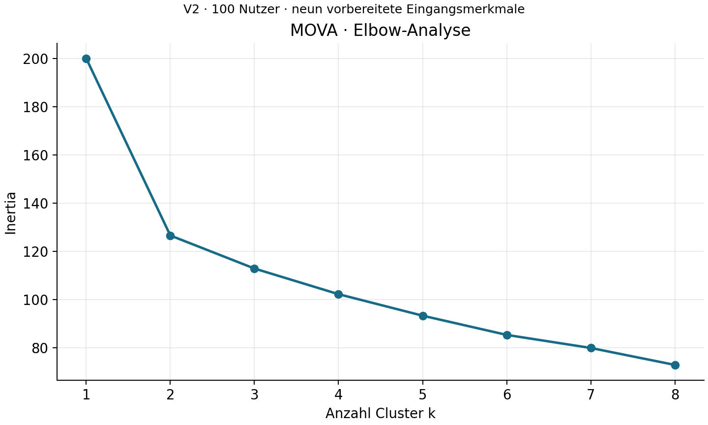
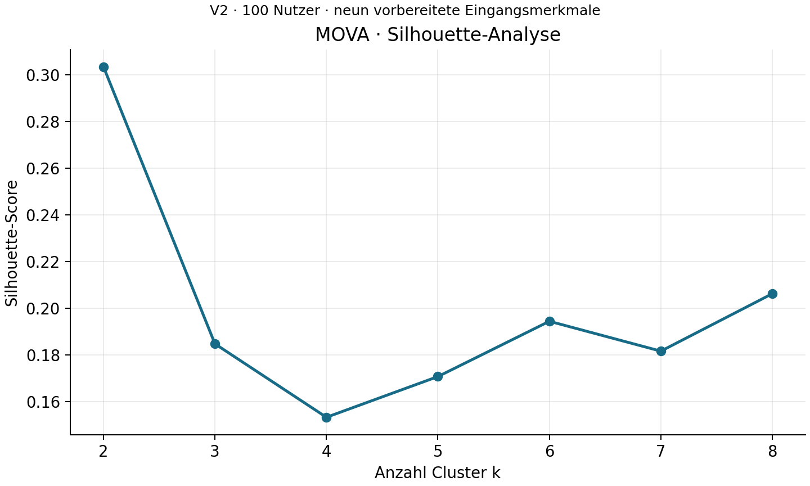
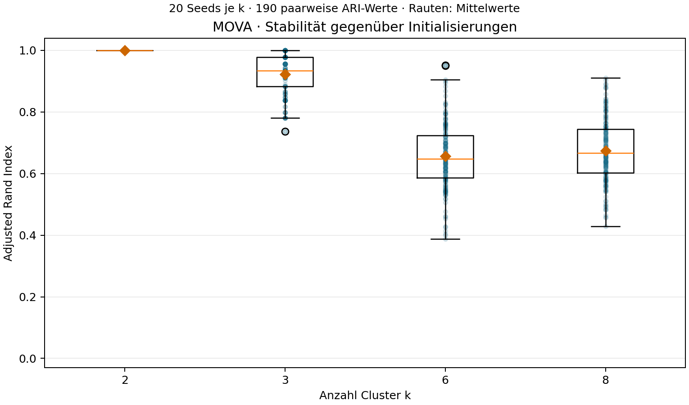
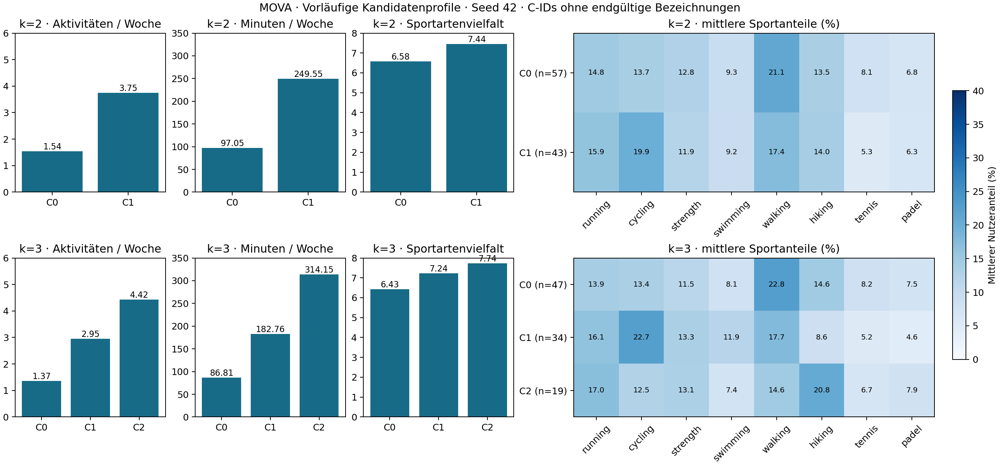
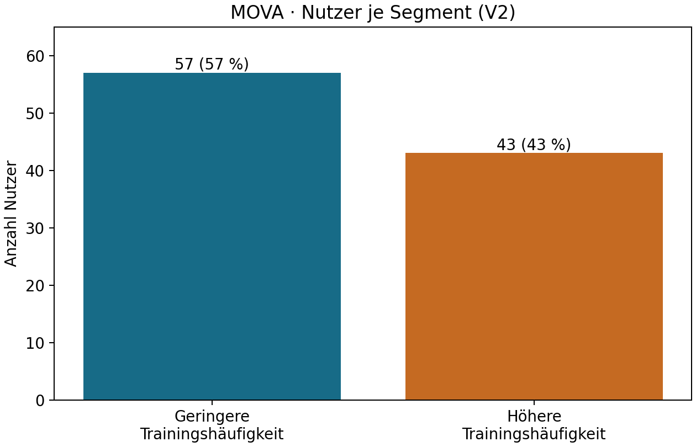
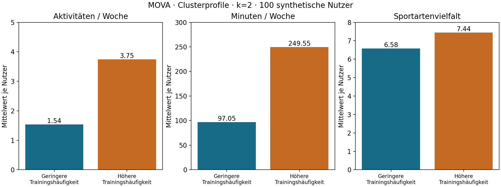
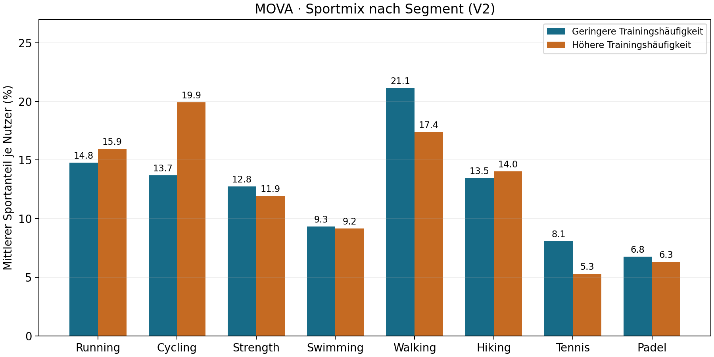

# MOVA – AP 5.1: explorative K-Means-Modellierung

Stand: 31.10.2026. Tatsächlich ausgeführt im Worktree `/workspace/MOVA-AP5`, Branch
`ap5-machine-learning`, Basis `1b26533d2ceea30478577bd519244c245dd3e558` (Merge PR #4).
CRISP-DM: 4.1 Select Modeling Technique, 4.2 Generate Test Design,
4.3 Build Model, 4.4 Assess Model. Keine neue CRISP-DM-Iteration behauptet.

## Ziel und tatsächlich verwendete Daten

Untersuchen, welche Clusterzahlen für eine spätere gemeinsame Auswahl geeignet sind.
Keine endgültige Clusterzahl, keine persistierten Modelle oder Nutzerzuordnungen und
keine Interpretation von Nutzerprofilen. Ausschließlich die aktive synthetische V2:
`data/processed/kmeans_user_features_scaled.csv`, 100 eindeutige Nutzer × neun Eingänge
(zusätzlich user_id als Metadatum). Ergänzend gelesen: unskalierte Nutzertabelle,
Skalierungsparameter, Merkmalskonzept und AP-4-Ausführungsnachweis.

Die Eingänge in exakter Reihenfolge:

1. avg_activities_per_week
2. share_running
3. share_cycling
4. share_strength
5. share_swimming
6. share_walking
7. share_hiking
8. share_tennis
9. share_padel

Häufigkeit beschreibt das Aktivitätsniveau einschließlich Nullwochen; alle acht Anteile
beschreiben den vollständigen Sportmix symmetrisch. avg_duration_per_week überschneidet
sich stark mit Häufigkeit; sport_diversity ist aus den Anteilen ableitbar und hängt von
der Beobachtungsmenge ab. Beide bleiben spätere Interpretationsmerkmale. user_id,
freiwillige Interessen und interne Simulationsprofile gehen nicht in die Modellmatrix ein.

AP 4 hat die Merkmale bereits mit StandardScaler (ddof=0) standardisiert und die acht
Sportkoordinaten anschließend mit 1/√8 gewichtet. Erneutes Standardisieren würde diese
Blockgewichtung aufheben, erneutes Gewichten den Sportmix zusätzlich abschwächen.
Deshalb übernimmt das Skript die CSV-Werte unverändert. Eine Kontrollrechnung mit den
gespeicherten Parametern prüft die Herkunft, ohne einen Scaler anzupassen oder X zu ersetzen.

## Technik, Parameter und Testdesign

K-Means ordnet jeden Nutzer dem nächsten Zentrum zu und aktualisiert die Zentren als
Mittelwerte ihrer zugeordneten Nutzer. Diese Schritte wiederholen sich bis zum
Konvergenzkriterium oder der Iterationsgrenze. Minimiert wird die Summe quadrierter
euklidischer Abstände zu den jeweils zugeordneten Zentren (Inertia). Das Verfahren
findet lokale Lösungen; eine globale Optimalität ist nicht garantiert.

| Parameter | Tatsächlicher Wert | Bedeutung |
| --- | --- | --- |
| n_clusters | 1–8 | acht getrennte explorative Modelle |
| init | k-means++ | probabilistische Initialisierung mit räumlich verteilten Zentren |
| random_state | 42 | reproduzierbarer Zufallszustand |
| n_init | 20 | 20 Initialisierungen; beste Lösung nach Inertia behalten |
| max_iter | 300 | maximale Iterationszahl pro Initialisierung |
| algorithm | lloyd | Zuordnung und Zentrenaktualisierung |
| tol | 0,0001 | relatives Konvergenzkriterium der Zentrenverschiebung |

Die berichteten Iterationen gehören zur ausgewählten Lösung, nicht zur Summe der 20 Starts.
Software: Python 3.12.14, scikit-learn 1.8.0, NumPy 2.3.5, pandas 2.2.3,
Matplotlib 3.10.8. Numerische Threadpools sind auf einen Thread begrenzt.

Deskriptives unüberwachtes Profiling aller 100 Nutzer: kein Regressions-Train/Test-Split,
keine Zielvariable und keine externe Ground Truth. Alle k werden auf derselben Matrix
bewertet. Das ist interne Modellauswahl, keine unabhängige Generalisierungsbewertung.

## Elbow und Silhouette

Niedrigere Inertia bedeutet kompaktere Cluster im festgelegten gewichteten Merkmalsraum.
Zusätzliche Zentren erlauben theoretisch eine mindestens ebenso gute Anpassung; bei
lokaler Optimierung sind Anstiege technisch möglich. Das Skript kennzeichnet Anstiege
über 1e−10, ohne Werte oder Parameter nachträglich zu verändern. Hier sinkt Inertia
für jedes zusätzliche k. Das Minimum im untersuchten Bereich ist kein Beweis für ein
optimales k: bei einem Zentrum pro Nutzer wäre Inertia null, aber keine nützliche Segmentierung.
Die Elbow-Methode sucht eine Abflachung als Entscheidungshilfe.

Für jeden Nutzer ist a die mittlere euklidische Distanz innerhalb des eigenen Clusters
und b die kleinste mittlere Distanz zu einem anderen Cluster. Die Silhouette ist
(b−a)/max(a,b); der Score mittelt über alle Nutzer. Werte nahe 1 bedeuten relativ
kompakte und getrennte Gruppen, nahe 0 Überlappung und negative Werte mögliche
Fehlzuordnungen. Singleton-Silhouetten behandelt scikit-learn als 0. Für k=1 ist der
Score nicht definiert. Es wurden alle 100 Nutzer ohne Sampling verwendet.

## Tatsächlich beobachtete Ergebnisse

CSV speichert volle Float-Präzision; unten sind Kennzahlen auf neun Nachkommastellen gerundet.
Min/max bleiben für k=1 gemäß Tabellenkonvention leer; dessen einziges Cluster hat 100 Nutzer.

| k | Inertia | Silhouette | Iterationen | Entstandene Cluster | Min | Max |
| --- | --- | --- | --- | --- | --- | --- |
| 1 | 200.000000000 |  | 2 | 1 |  |  |
| 2 | 126.497906529 | 0.303337152 | 3 | 2 | 43 | 57 |
| 3 | 112.790706249 | 0.184642381 | 5 | 3 | 19 | 47 |
| 4 | 102.143819212 | 0.153184691 | 13 | 4 | 13 | 38 |
| 5 | 93.219615218 | 0.170625407 | 5 | 5 | 8 | 35 |
| 6 | 85.243884056 | 0.194309023 | 7 | 6 | 6 | 29 |
| 7 | 79.819436192 | 0.181515487 | 5 | 7 | 6 | 25 |
| 8 | 72.787722478 | 0.206129630 | 5 | 8 | 6 | 29 |

### Vollständige Clustergrößen

Reihenfolge jeweils lokale Cluster-IDs 0 bis k−1; IDs sind beliebige technische Kennungen,
keine semantischen Bezeichnungen und zwischen k nicht vergleichbar. Keine Nutzerlabels exportiert.

| k | Größen in ID-Reihenfolge | Summe |
| --- | --- | --- |
| 1 | 100 | 100 |
| 2 | 57, 43 | 100 |
| 3 | 47, 34, 19 | 100 |
| 4 | 20, 13, 38, 29 | 100 |
| 5 | 24, 35, 18, 8, 15 | 100 |
| 6 | 10, 22, 29, 8, 6, 25 | 100 |
| 7 | 15, 13, 12, 25, 8, 21, 6 | 100 |
| 8 | 8, 29, 8, 10, 6, 13, 10, 16 | 100 |

## Diagramme und vorläufige Bewertung

Der größte Rückgang liegt bei 1→2: rund 73,5021 Inertia-Einheiten (36,75 %).
Danach folgen Rückgänge von rund 13,7072; 10,6469; 8,9242; 7,9757; 5,4244; 7,0317.
Eine deutliche erste Abflachung ist bei k=2 sichtbar. Der Verlauf danach ist graduell;
bei 7→8 fällt Inertia wieder etwas stärker. Kein eindeutiger zusätzlicher Elbow.

k=2 hat mit 0,303337 den höchsten Score und Größen 57/43. Es ist der stärkste
vorläufige Kandidat für eine übersichtliche grobe Segmentierung. Auch dieser Score
beweist keine stark getrennten realen Nutzergruppen. Unter den feineren Lösungen hat
k=8 den höchsten Score (0,206130), gefolgt von k=6 (0,194309), k=3 (0,184642),
k=7 (0,181515), k=5 (0,170625) und k=4 (0,153185).

k=3 ist eine übersichtliche Vergleichslösung (47/34/19), hat aber einen deutlich
niedrigeren Silhouette-Score als k=2. k=4 ist nach Silhouette der schwächste Kandidat.
k=5 verbessert den Score etwas, bringt aber bereits ein Cluster mit acht Nutzern.
k=6 bietet einen lokalen Silhouette-Höhepunkt und sechs Gruppen; k=7 verbessert den
Score gegenüber k=6 nicht. k=8 gewinnt unter den feineren Lösungen mathematisch,
erhöht aber die Anzahl später zu erklärender Segmente auf acht.

Fachliche Warnschwelle im Skript: weniger als fünf Nutzer (<5 %), keine Ausschlussregel.
Kein Modell unterschreitet sie, keine Singletons und keine leeren Cluster.
Zusätzlich sind Gruppen mit sechs bis acht Nutzern bei k=5–8 praktisch klein und
bei nur 100 synthetischen Nutzern vorsichtig zu bewerten. Alle Modelle erzeugen
exakt k Cluster und erreichen die Iterationsgrenze nicht; keine Laufzeitwarnungen.

**Vorläufige Kandidaten: k=2 und k=3 für eine verständliche grobe Segmentierung;
k=6 und k=8 als ergänzende feinere Vergleichskandidaten.** Der Zielkonflikt liegt
zwischen interner Trennung, zunehmender Kompaktheit, Anzahl erklärbarer Gruppen und
kleinen Segmenten. Keine Kennzahl begründet allein ein finales k. Die endgültige
Auswahl bleibt ausdrücklich beim Projektteam.

## Validierung und Reproduzierbarkeit – tatsächlich ausgeführt

Aufruf im Worktree: `python src/modeling_kmeans_k_selection.py`.
Zwei vollständige Ausführungen mit identischer Matrix und Einstellungen durchgeführt.
Die CSV und beide PNGs sind bytegleich; der zweite Lauf vergleicht die neu berechneten
Bytes mit vorhandenen Ausgaben und bricht bei Abweichung ab. Auch beide JSON-
Konsolenprotokolle sind bytegleich (lokal unter work). Konstante PNG-Metadaten,
Schrift DejaVu Sans und feste Renderparameter; keine Garantie über andere Software-
oder Plattformversionen hinweg. Beide Diagramme zusätzlich visuell geprüft.

100 eindeutige nicht leere IDs, neun exakt erlaubte Eingänge, endliche Werte, V2,
Merkmalsreihenfolge und AP-4-Quellhashes geprüft. Jeder Lauf prüft die unveränderten
bestehenden Daten, Skripte, Dokumentationen und Modellparameter per SHA-256 vor/nach.
Alle acht Modelle ordnen 100 Nutzer zu; Größen summieren sich jeweils zu 100.
Inertia nicht negativ und monoton fallend; Silhouetten im Bereich [−1,1].
Keine Neuskalierung und keine Interpretationseingänge.

Automatisierte Tests: `python -m unittest discover -s tests -v`.
Acht neue Tests prüfen unveränderte X-Werte/unterbundenen Scaler-Fit, unzulässige
Merkmale, fehlende/doppelte Nutzer, nicht endliche Werte, ungültige k,
Ergebnisinvarianten einschließlich unabhängiger k=1-Inertia, unabhängige Nachrechnung
der k=2-Inertia/Silhouette sowie Wiederholung mit bytegleicher Ergebnistabelle und
unverändertem X. Fehlerfälle verwenden nur Speicherkopien tatsächlicher V2-Daten.
Zusammen mit den 22 AP-4-Tests: 30 Tests bestanden.
Abschließend alle zuvor versionierten Dateien gegen HEAD-Blob-Hashes geprüft:
keine bestehenden Projektdateien verändert. Kein Commit und kein Pull Request.

## Fachliche Annahmen, Einschränkungen und offene Entscheidungen

Annahmen: euklidische Geometrie, kompakte Gruppen und gleiche Blockstreuung für
Aktivitätsniveau und Sportmix sind fachliche Startentscheidungen, keine optimierten
Wahrheiten. Sportanteile sind kompositionell und haben nur sieben Freiheitsgrade;
Standardisierung betont Anteile mit kleiner ursprünglicher Streuung. K-Means reagiert
auf extreme Werte und bevorzugt kompakte, ungefähr kugelförmige Gruppen.
100 synthetische Nutzer und 26 Wochen erlauben keine Aussage über reale Garmin-Nutzer.
Die Kennzahlen vergleichen dieselben Daten, auf denen optimiert wurde.
Ein fester Seed und 20 Starts belegen Reproduzierbarkeit, aber keine Stabilität über
andere Seeds, Stichproben oder Messfehler. Es wurde kein solcher Stabilitätstest behauptet.

Offen: endgültiges k und spätere fachliche Verständlichkeit der Segmente. Für AP 5.2
zunächst gemeinsam die vier Kandidaten bewerten und den Vergleich auf wenige k
begrenzen; anschließend separat autorisierte Stabilitätsprüfung über mehrere Seeds
und gegebenenfalls Resampling planen. Profile erst nach vereinbartem nächsten Schritt
beschreiben. Keine Regression, Empfehlungen oder endgültigen Artefakte in AP 5.1.

# AP 5.2 – Stabilitätsprüfung und vorläufiger Kandidatenvergleich

Stand: 31.10.2026. CRISP-DM 4.3 Build Model und 4.4 Assess Model.
Worktree `/workspace/MOVA-AP5`, Branch `ap5-machine-learning`, unveränderte Basis
`1b26533d2ceea30478577bd519244c245dd3e558`. Dieser Abschnitt ergänzt AP 5.1;
dessen Resultate und Dateien bleiben erhalten. Historische Aussagen zu damals noch
nicht durchgeführten Prüfungen beziehen sich auf den jeweiligen Arbeitsschritt.

## Ziel und tatsächlich ausgeführtes Untersuchungsdesign

Prüfung der Empfindlichkeit gegenüber der zufälligen K-Means-Initialisierung für
k=2, 3, 6 und 8. Neue Implementierung: `src/modeling_kmeans_stability.py`.
Pro k exakt 20 verschiedene Seeds: **0 bis 18 sowie 42**, vor der Ergebnisbewertung
festgelegt. Keine Auswahl günstiger Seeds anhand der Resultate. 80 Modelle je
vollständigem Durchlauf. Die übrigen Parameter entsprechen AP 5.1:
`init="k-means++"`, `n_init=20`, `max_iter=300`, `algorithm="lloyd"`, `tol=1e-4`.
20 Seeds mit je 20 internen Starts bedeuten insgesamt 1.600 Initialisierungen pro
vollständigem Durchlauf. Die beste Inertia-Lösung jedes Seeds wird bewertet.
Mehrere Seeds prüfen, ob diese Optimierungsroutine dieselbe Partition findet.

Software unverändert: Python 3.12.14, scikit-learn 1.8.0, NumPy 2.3.5,
pandas 2.2.3, Matplotlib 3.10.8; ein numerischer Thread.
Aktive V2, dieselben 100 Nutzer und dieselben neun vorbereiteten Merkmale wie AP 5.1.
Keine neue Skalierung, Gewichtung oder Merkmalsauswahl. Das Skript übernimmt die
skalierte Matrix unverändert. Unskalierte Daten werden erst nach dem Modellieren
zur aggregierten Beschreibung verwendet. user_id ist ausschließlich Join-Schlüssel.
Interessen, interne Simulationsprofile und Angebote gehen nicht in die Clusterbildung ein.

Pro Modell werden Inertia, euklidischer Silhouette-Score auf allen Nutzern,
Iterationen, Clusteranzahl und vollständige Clustergrößen gespeichert. Nutzerlabels
bleiben im Speicher. Die Seed-42-Kennzahlen wurden für alle vier k gegen die
bestehende AP-5.1-Tabelle geprüft (atol=rtol=1e-12).

## Was der Adjusted Rand Index misst

ARI vergleicht zwei Partitionen derselben Nutzer anhand der Nutzerpaare: Werden
zwei Nutzer in beiden Partitionen zusammen oder getrennt gruppiert? Die
Übereinstimmung wird um die unter einem Zufallsmodell erwartete Übereinstimmung
korrigiert. ARI=1 bedeutet identische Gruppierung bis auf beliebige Cluster-IDs,
Werte nahe 0 entsprechen zufallsähnlicher Übereinstimmung; negative Werte sind
möglich. Berechnet mit `sklearn.metrics.adjusted_rand_score`.
Eine Umbenennung der IDs verändert ARI nicht; dies ist automatisiert getestet.

Pro k werden alle 20×19/2 = **190 ungeordneten Paare** ohne Selbstvergleiche
berechnet. Zusätzlich werden die **19 anderen Seeds** mit Seed 42 verglichen;
der triviale Selbstvergleich ist aus deren Zusammenfassung ausgeschlossen.
Die Einzellauftabelle enthält für Seed 42 selbst dennoch korrekt ARI=1.
Unterschiedliche Partitionen werden nach kanonischer Umbenennung der IDs gezählt.

**A: Initialisierungsstabilität** auf derselben festen Matrix wird hier gemessen.
**B: Generalisierbarkeit auf neue Nutzerdaten** wird nicht untersucht. Ein ARI=1
belegt weder reale Nutzersegmente noch Stabilität bei Stichprobenänderungen,
zeitlicher Veränderung oder Messfehlern. Es fand kein Resampling statt.

## Gemessene Stabilitätsergebnisse

| k | ARI Mittel (190 Paare) | ARI Minimum | ARI Maximum | Unterschiedliche Partitionen |
| --- | --- | --- | --- | --- |
| 2 | 1.000000 | 1.000000 | 1.000000 | 1 |
| 3 | 0.922837 | 0.736289 | 1.000000 | 9 |
| 6 | 0.657272 | 0.387081 | 0.951337 | 20 |
| 8 | 0.673694 | 0.429207 | 0.910609 | 20 |

| k | ARI zu Seed 42: Mittel | Minimum | Maximum |
| --- | --- | --- | --- |
| 2 | 1.000000 | 1.000000 | 1.000000 |
| 3 | 0.931681 | 0.798022 | 0.977413 |
| 6 | 0.669458 | 0.399183 | 0.883097 |
| 8 | 0.647358 | 0.458757 | 0.903417 |

Bei k=2 liefern alle 20 Seeds exakt dieselbe Gruppierung (bis auf die IDs).
Bei k=3 gibt es neun Partitionen und insgesamt hohe, aber nicht perfekte
Übereinstimmung. Kein anderer Seed reproduziert Seed 42 exakt (Maximum zu 42
unter 1). k=6 und k=8 erzeugen jeweils 20 verschiedene Partitionen; deren
Optimierungsergebnisse hängen stärker vom Seed ab, obwohl jeder Seed 20 Starts nutzt.
Die 190 ARI-Werte teilen sich Modelle und sind keine unabhängigen Beobachtungen;
Mittelwerte beschreiben dieses feste Design, keine Konfidenzintervalle.

### Verteilung von Silhouette, Inertia und Clustergrößen

Standardabweichung der Silhouette: deskriptiv über die 20 festgelegten Seeds,
**ddof=0**. Werte unten gerundet; CSVs speichern 17 signifikante Stellen.

| k | Silhouette Mittel | SD | Minimum | Maximum | Kleinste Clustergröße über alle Seeds |
| --- | --- | --- | --- | --- | --- |
| 2 | 0.303337 | 0.000000 | 0.303337 | 0.303337 | 43 |
| 3 | 0.180135 | 0.007285 | 0.165024 | 0.192600 | 17 |
| 6 | 0.184549 | 0.009104 | 0.159617 | 0.196726 | 6 |
| 8 | 0.199977 | 0.009728 | 0.183603 | 0.218225 | 2 |

| k | Inertia Mittel | Minimum | Maximum |
| --- | --- | --- | --- |
| 2 | 126.497907 | 126.497907 | 126.497907 |
| 3 | 112.776192 | 112.721381 | 112.919606 |
| 6 | 85.562010 | 84.581862 | 87.411056 |
| 8 | 73.161628 | 72.370411 | 73.955546 |

Geringste Unterschiede der Inertia im Bereich letzter Float-Stellen sind numerische
Rundungseffekte; sie werden nicht korrigiert. k=2 übertrifft alle beobachteten anderen
Kandidaten beim Silhouette-Score, auch deren jeweils besten Seed. k=8 erreicht unter
den feineren Kandidaten die höchsten Silhouetten, aber deutlich geringere Stabilität
als k=2/3. k=6 ist nach mittlerer Silhouette nur geringfügig besser als k=3.

Die vollständigen Größen jedes einzelnen Laufs stehen als JSON-Dictionary in
`cluster_sizes` der Einzellauftabelle (lokale IDs, nicht über Seeds vergleichbar).
Bei k=2 bleiben die Größen immer 57/43. Die kleinste Gruppe über alle Seeds beträgt
bei k=3 17 Nutzer und bei k=6 sechs Nutzer. Bei k=8 entstehen in **acht von 20**
Läufen Gruppen unter fünf Nutzern:

| Seed | Kleinste Gruppe |
| --- | --- |
| 4 | 3 |
| 9 | 3 |
| 11 | 2 |
| 12 | 2 |
| 13 | 3 |
| 16 | 3 |
| 17 | 2 |
| 18 | 3 |

Die AP-5.1-Schwelle <5 ist ein fachlicher Prüfhinweis, keine automatische
Ausschlussregel. Keine leeren Cluster; alle 80 Modelle erzeugen genau k Gruppen.
Keine Laufzeitwarnungen und keine erreichte Iterationsgrenze.

## Gemessene vorläufige Kandidatenprofile – Seed 42

Join der Nutzerzuordnungen mit den unskalierten Daten ausschließlich über `user_id`,
mit überprüfter 1:1-Verbindung und identischer Nutzermenge. Cluster-IDs C0 usw.
sind technische Kennungen ohne endgültige Segmentnamen. Umfang und Vielfalt
wurden nicht für die Zuordnung verwendet. Alle Mittelwerte gewichten Nutzer gleich,
Sportanteile sind keine gepoolten Aktivitätsanteile. Top 3 werden nach mittlerem
Anteil absteigend, bei Gleichstand alphabetisch ermittelt. Ein Rang allein belegt
keine ausgeprägte Spezialisierung.

| k | Vorläufige ID | Nutzer | Aktivitäten/Woche | Minuten/Woche | Sportartenvielfalt | Top 3 nach Anteil |
| --- | --- | --- | --- | --- | --- | --- |
| 2 | C0 | 57 | 1.5351 | 97.0544 | 6.5789 | walking / running / cycling |
| 2 | C1 | 43 | 3.7478 | 249.5486 | 7.4419 | cycling / walking / running |
| 3 | C0 | 47 | 1.3658 | 86.8097 | 6.4255 | walking / hiking / running |
| 3 | C1 | 34 | 2.9536 | 182.7579 | 7.2353 | cycling / walking / running |
| 3 | C2 | 19 | 4.4231 | 314.1508 | 7.7368 | hiking / running / walking |

Mittlere Nutzeranteile in Prozent:

| k | ID | Running | Cycling | Strength | Swimming | Walking | Hiking | Tennis | Padel |
| --- | --- | --- | --- | --- | --- | --- | --- | --- | --- |
| 2 | C0 | 14.77 | 13.68 | 12.76 | 9.34 | 21.12 | 13.47 | 8.10 | 6.77 |
| 2 | C1 | 15.95 | 19.93 | 11.94 | 9.16 | 17.38 | 14.02 | 5.30 | 6.33 |
| 3 | C0 | 13.95 | 13.38 | 11.47 | 8.12 | 22.80 | 14.56 | 8.23 | 7.48 |
| 3 | C1 | 16.14 | 22.65 | 13.29 | 11.86 | 17.73 | 8.57 | 5.17 | 4.60 |
| 3 | C2 | 17.01 | 12.50 | 13.13 | 7.42 | 14.57 | 20.78 | 6.67 | 7.92 |

### Fachliche Interpretation der beobachteten Unterschiede

k=2 trennt vor allem Häufigkeit und korrelierten Umfang: 1,54 gegenüber 3,75
Aktivitäten und 97 gegenüber 250 Minuten pro Woche. Sportmixunterschiede sind
vorhanden, aber moderat: Cycling 13,68 % gegenüber 19,93 %, Walking 21,12 %
gegenüber 17,38 %. Viele andere Anteile liegen nah beieinander. Daraus lassen sich
keine zwei klar sportartspezialisierten Nutzersegmente ableiten.

k=3 differenziert das Aktivitätsniveau weiter: 1,37 / 2,95 / 4,42 Aktivitäten
pro Woche. C1 hat den höchsten Cycling-Anteil (22,65 %), C2 den höchsten
Hiking-Anteil (20,78 %; C1 nur 8,57 %). C0 hat den höchsten Walking-Anteil
(22,80 %). Das ist zusätzlicher beschreibender Mehrwert, aber keine saubere
Trennung nach einzelnen Sportarten. Alle Gruppen haben einen gemischten Sportmix.

Als zusätzliche tatsächlich ausgeführte Diagnose wurde im Speicher die erklärte
Zwischengruppenstreuung pro Eingangskoordinate berechnet:
`B_j = Σ_c n_c × (mean(X_c,j) − mean(X_j))²`.
Dies zerlegt die durch Zentren erklärte quadrierte Streuung; es ist keine neue
Gewichtung und keine kausale Wichtigkeitsanalyse.

| k | B Häufigkeit | B Sportmix (Summe acht Koordinaten) | Häufigkeitsanteil an B gesamt |
| --- | --- | --- | --- |
| 2 | 72.458768 | 1.043325 | 98.58 % |
| 3 | 83.150656 | 4.058637 | 95.35 % |

Bei beiden Lösungen entfällt der weitaus größte Teil der erklärten Streuung auf die
Häufigkeit, obwohl die vorbereiteten Blöcke insgesamt gleiche Varianzsummen haben.
Das unterstützt die Interpretation einer überwiegend niveaubasierten Segmentierung.
Die stärkere Sportmixdifferenzierung von k=3 bleibt nachgeordnet.

Zusätzliche Kreuztabelle der Seed-42-Partitionen, ausschließlich aggregierte Anzahlen:

| k=2-ID | k=3 C0 | k=3 C1 | k=3 C2 |
| --- | --- | --- | --- |
| C0 | 47 | 10 | 0 |
| C1 | 0 | 24 | 19 |

k=3 ist somit keine rein hierarchische Aufteilung einer bestehenden Gruppe: C1
enthält Nutzer aus beiden k=2-Gruppen. Cluster-IDs wurden für diese Kreuztabelle
nicht semantisch gleichgesetzt.

Für MOVA könnten die Niveauunterschiede später unterschiedliche Aktivitätsumfänge
adressieren. Dies ist eine fachliche Einsatzhypothese, keine berechnete Empfehlung
und kein nachgewiesener Geschäftsnutzen. Für konkrete Sportvorschläge ist der grobe
Gruppenmittelwert allein wenig spezifisch; individuelle Präferenzen und eine
separat zu validierende Empfehlungslogik bleiben erforderlich.

## Visualisierungen

190 ARI-Werte je Kandidat, Boxplots mit Median/Quartilen, Whisker bis 1,5 IQR und
Ausreißermarkierungen, transparente Punkte sowie Rauten für Mittelwerte. k=2
kollabiert zu ARI=1. Punkte überlagern sich; ihre Sichtbarkeit kodiert keine zusätzliche
Stichprobengröße. Die ARI-Werte sind abhängig, keine Unsicherheitsintervalle.

Getrennte Achsen für Aktivitäten, Minuten, Vielfalt und Sportanteile. Gleiche Skalen
je Maß über beide k, Sportmix als Heatmap mit einheitlicher Prozentfarbskala.
Nur tatsächlich berechnete Seed-42-Mittelwerte, Gruppengrößen und technische IDs.
Beide Abbildungen wurden visuell auf Lesbarkeit, Einheiten und Beschriftung geprüft.

## Reproduzierbarkeit, Validierungen und Tests

`python src/modeling_kmeans_stability.py` zweimal vollständig ausgeführt: jeweils
80 Modelle. Alle drei CSVs und beide PNGs **bytegleich**. Der zweite Lauf berechnet
jede Ausgabe neu und akzeptiert vorhandene Dateien nur bei vollständiger Bytegleichheit.
Zusätzlich sind die Konsolenprotokolle identisch (`work/ap52_run1.log` und
`work/ap52_run2.log`). Keine Nutzerlabels in Ausgabedateien oder Logs.

Zehn neue Tests in `tests/test_modeling_kmeans_stability.py` prüfen:
vollständiges 80-Läufe-Design, gültige Cluster-/Kennzahlen, Labelumbenennungsinvarianz,
190-Paar-Enumeration und 19 Referenzvergleiche, Zusammenfassungsstatistiken,
AP-5.1-Referenzen, reihenfolgeunabhängigen ID-Join und unabhängige Profilmittelwerte,
fehlerhafte Nutzerverknüpfungen, ungültige Seeds/Matrix, Wiederholbarkeit ohne
Scaler-Fit und Rolle der Interpretationsmerkmale. Fehlerfälle ausschließlich
auf Speicherkopien vorhandener V2-Daten.

`python -m unittest discover -s tests -v`: **40 Tests bestanden**
(22 AP 4 + acht AP 5.1 + zehn AP 5.2). Der vollständige zweite Modelllauf und die
Tests wurden vor dieser Dokumentationsergänzung abgeschlossen. Alle bisherigen
Dateien einschließlich uncommitteter AP-5.1-Artefakte wurden vor Arbeitsbeginn
per SHA-256 erfasst; abschließend sind sie unverändert, mit Ausnahme der ausdrücklich
autorisierten append-only Ergänzung dieses Ausführungsnachweises. Alle 103
versionierten Dateien bleiben bytegleich mit HEAD. Keine Rohdaten, AP-4-Skripte,
Skalierungsparameter oder AP-5.1-Ergebnistabellen/Diagramme verändert.

## Empfehlung, Grenzen und offene Entscheidung

**Begründete Empfehlung für die spätere endgültige Auswahl: k=2.** Es verbindet
den AP-5.1-Elbow bei 2, den mit Abstand höchsten Silhouette-Score in allen 20 Seeds,
identische Gruppierungen über diese Seeds und gut besetzte Gruppen (57/43).
Für eine einfache niveaubasierte MOVA-Segmentierung ist es der überzeugendste
untersuchte Kandidat. k=3 bleibt eine Alternative, falls drei Aktivitätsniveaus mit
zusätzlicher Cycling-/Hiking-Differenzierung fachlich benötigt werden. Der Mehrwert
ist begrenzt und geht mit geringerem Silhouette-Score und Seed-Abhängigkeit einher.
k=6/8 liefern mehr Details, aber weniger stabile Gruppierungen; k=8 teilweise sehr
kleine Gruppen. Diese Befunde sprechen aktuell gegen die zusätzliche Komplexität.

Das ist eine Empfehlung, **keine Festlegung eines finalen k**. Die endgültige
Entscheidung trifft das Projektteam gemeinsam nach Sichtung dieser Ergebnisse.
Bei Ziel „deutlich verschiedene Sporttypen“ reichen die aktuellen k=2/3-Profile
nicht als Nachweis solcher Typen. Es werden keine endgültigen Clusterbezeichnungen
vergeben oder passenden Nutzersegmente erfunden.

Grenzen: ausschließlich Initialisierungen desselben Algorithmus auf derselben
synthetischen V2. Keine neuen Nutzer, keine zeitliche Validierung, keine Stichproben-
oder Gewichtungssensitivität. Die 20 Seeds mit n_init=20 prüfen die konkrete
Multi-Start-Routine, nicht die Stabilität einzelner Initialisierungen mit n_init=1.
Hohe Stabilität ist kein Beleg optimaler fachlicher Gruppen. Die kompositionellen
Sportanteile, euklidische Geometrie, Ausreißerempfindlichkeit und subjektive
Blockgewichtung aus AP 5.1 bleiben methodische Einschränkungen. Gruppenmittelwerte
verdecken individuelle Streuung und Überlappung. Trainingsminuten und Vielfalt sind
nachträgliche Beschreibung, keine unabhängige Bestätigung der Modellqualität.
Keine Generalisierung auf reale Garmin-Nutzer oder kausale Wirkung behauptet.

Neue Dateien: Stabilitätsskript, zugehörige Tests, drei Ergebnistabellen und zwei
Diagramme; dieser Bericht wurde ergänzt. Kein finales Modell, keine endgültigen
Nutzerlabels, keine Regression und keine Empfehlungen berechnet. Kein Commit,
kein Pull Request und keine unbegründete CRISP-DM-Iteration.

# AP 5.3 – finales K-Means-Modell und Nutzersegmentierung

Stand: 31.10.2026. CRISP-DM 4.3 Build Model, 4.4 Assess Model.
Worktree `/workspace/MOVA-AP5`, Branch `ap5-machine-learning`, Basis unverändert
`1b26533d2ceea30478577bd519244c245dd3e558`. AP 5.1/5.2 bleiben als historische
Ausführungsnachweise erhalten; deren damals offene Entscheidung wurde jetzt getroffen.

## Empirisch begründete Modellauswahl und Teamentscheidung

Das Projektteam hat für die erste MOVA-Version **k=2 endgültig ausgewählt**.
Die Entscheidung stützt sich auf die tatsächlichen vorhandenen Ergebnisse:

- Höchster Silhouette-Score in AP 5.1: 0,30333715184382104.
- Deutliche Elbow-Abflachung nach dem Rückgang der Inertia von rund 200 auf 126,497907.
- AP 5.2: ARI=1 über alle 190 Seed-Paare aus 20 Random Seeds mit jeweils n_init=20.
- Zwei ausreichend große Gruppen mit 57 und 43 Nutzern.
- Fachlich verständliche Unterschiede im Aktivitätsniveau; k=3 liefert begrenzten
  zusätzlichen Sportmixnutzen bei geringerem Silhouette-Score und Seed-Abhängigkeit.

Dies ist eine empirisch begründete Modellauswahl innerhalb der synthetischen V2,
kein Nachweis eines universell optimalen k oder einer Generalisierbarkeit auf reale
Garmin-Nutzer. Die Modellauswahl ist mit diesem Schritt abgeschlossen; keine neue
CRISP-DM-Iteration behauptet.

## Tatsächlich ausgeführtes Training

Neues Skript: `src/modeling_kmeans_final.py`.
Aufruf: `python src/modeling_kmeans_final.py`.
100 synthetische Nutzer, identische neun Eingänge in folgender Reihenfolge:

1. avg_activities_per_week
2. share_running
3. share_cycling
4. share_strength
5. share_swimming
6. share_walking
7. share_hiking
8. share_tennis
9. share_padel

Ausschließlich `data/processed/kmeans_user_features_scaled.csv` liefert die
Trainingswerte. Diese sind bereits in AP 4 standardisiert und für den Sportmix
mit 1/√8 gewichtet worden. Sie wurden exakt übernommen, weder erneut standardisiert
noch gewichtet. Das finale Artefakt enthält KMeans, keine Transformationspipeline.
Neue Eingaben müssten deshalb später ausdrücklich mit den gespeicherten AP-4-
Parametern transformiert werden, ohne Refit; rohe Merkmalswerte dürfen nicht direkt
an dieses Modell übergeben werden. `feature_names_in_` speichert die Reihenfolge.
user_id, Wochenminuten, Vielfalt, freiwillige Interessen, interne Simulationsprofile,
Angebote und zukünftige Empfehlungen sind keine Modelleingänge.

| Parameter | Tatsächlich verwendeter Wert |
| --- | --- |
| n_clusters | 2 |
| init | k-means++ |
| random_state | 42 |
| n_init | 20 |
| max_iter | 300 |
| algorithm | lloyd |
| tol | 0,0001 |
| copy_x | True |
| verbose | 0 |

Software: Python 3.12.14, scikit-learn 1.8.0, NumPy 2.3.5, pandas 2.2.3,
Joblib 1.5.3, Matplotlib 3.10.8. Numerische Threadpools auf einen Thread begrenzt.
Die Modellparameter sind zusätzlich als lesbares JSON gespeichert und unabhängig
von der binären Datei gegen die expliziten Sollwerte getestet.

## Modellartefakte, Provenienz und tatsächlich gemessene Ergebnisse

- `outputs/models/kmeans_final.joblib`: trainiertes finales Modell.
- `outputs/models/kmeans_final_metadata.json`: Datenversion V2, Eingabepfade und
  SHA-256, Modellhash, neun Feature-Namen und Reihenfolge, sämtliche Parameter,
  Softwareversionen, Zentren, Kennzahlen, Größen und ID-zu-Segment-Zuordnung.
- `data/processed/user_clusters.csv`: 100 eindeutige Nutzer, Spalten
  `user_id`, `cluster_id`, `segment_label`; keine fehlenden Zuordnungen.
- `outputs/tables/kmeans_final_cluster_profiles.csv`: zwei Clusterprofile aus
  unskalierten V2-Werten; Nutzer gleich gewichtet, keine gepoolten Sportanteile.

Eingabe-SHA-256 (skalierte CSV): `73f1694e865c8f65b0eabb45f7a80bd439bbc9bfd4b6f281cffaa15da491d78f`.

Modell-SHA-256: `db285f3d0ccf5315bb5a70cfc4750a31e59eb3f5d00a3f1d96473348c08d2a2f`.

Metadaten enthalten zusätzlich die Hashes der unskalierten Nutzertabelle,
der unveränderten AP-4-Skalierungsparameter und der drei AP-5.1/5.2-Referenztabellen.
Das Modell wurde in diesem Projektlauf erzeugt und danach erneut geladen. Joblib
basiert auf Pickle: ausschließlich vertrauenswürdige Projektartefakte laden; ein
Hashvergleich prüft Dateikonsistenz, authentifiziert keine fremden Artefakte.

| Kennzahl | Tatsächliches Ergebnis |
| --- | --- |
| Nutzer | 100 |
| Modelleingänge | 9 |
| Cluster | 2 |
| Inertia | 126,49790652947819 |
| Silhouette, euklidisch | 0,30333715184382104 |
| Iterationen der ausgewählten Lösung | 3 |
| Clustergrößen | 57 und 43 |

Inertia und Silhouette entsprechen AP 5.1 innerhalb atol=rtol=1e-12.
Die Profile entsprechen den k=2-/Seed-42-Kandidatenprofilen aus AP 5.2 innerhalb
derselben Toleranz. Diese internen Kennzahlen sind keine Prognosegenauigkeit.

### Tatsächliche Clusterzentren

Koordinaten liegen im bereits standardisierten und gewichteten Merkmalsraum.
Negative Werte sind dort erwartbar und keine negativen Sportanteile. Rohwertprofile
werden separat aus den tatsächlichen unskalierten Nutzerdaten berechnet.

| Merkmal | Zentrum Cluster 0 | Zentrum Cluster 1 |
| --- | --- | --- |
| avg_activities_per_week | -0.739336716 | 0.980050996 |
| share_running | -0.010996925 | 0.014577320 |
| share_cycling | -0.059755710 | 0.079211058 |
| share_strength | 0.007707598 | -0.010217049 |
| share_swimming | 0.001851122 | -0.002453813 |
| share_walking | 0.036157289 | -0.047929430 |
| share_hiking | -0.006434970 | 0.008530076 |
| share_tennis | 0.051860974 | -0.068745942 |
| share_padel | 0.008824240 | -0.011697248 |

## Nachvollziehbare fachliche Benennung

Die technische ID wird nicht als fachliche Reihenfolge interpretiert. Zunächst
werden die Zuordnungen per `user_id` eindeutig 1:1 mit der unskalierten Tabelle
verbunden. Danach wird die mittlere `avg_activities_per_week` je Cluster berechnet.
Das Cluster mit dem niedrigeren Mittel erhält „Geringere Trainingshäufigkeit“,
das mit dem höheren „Höhere Trainingshäufigkeit“. Bei Gleichstand bricht das Skript
ab, statt willkürlich eine Rangfolge festzulegen. Ein automatisierter Test vertauscht
die IDs und bestätigt, dass die fachlichen Bezeichnungen für die Nutzer gleich bleiben.

| Technische ID | Fachliche Zuordnung | Nutzer | Aktivitäten/Woche |
| --- | --- | --- | --- |
| 0 | Geringere Trainingshäufigkeit | 57 | 1.535088 |
| 1 | Höhere Trainingshäufigkeit | 43 | 3.747764 |

Die Bezeichnungen sind ausschließlich relativ zu diesen 100 synthetischen Nutzern.
Sie bedeuten nicht Anfänger/Fortgeschrittene, niedrige/hohe Fitness oder gesundheitliche
Leistungsfähigkeit. Es wurde kein allgemeiner Grenzwert der Wochenhäufigkeit gelernt:
KMeans ordnet nach der Distanz in allen neun Koordinaten zu, erst anschließend werden
Gruppen anhand ihrer gemessenen Mittelwerte benannt.

## Finale Clusterprofile aus unskalierten V2-Daten

| Segment | Nutzer | Aktivitäten/Woche | Minuten/Woche | Sportartenvielfalt | Drei höchste mittlere Sportanteile |
| --- | --- | --- | --- | --- | --- |
| Geringere Trainingshäufigkeit | 57 | 1.5351 | 97.0544 | 6.5789 | walking / running / cycling |
| Höhere Trainingshäufigkeit | 43 | 3.7478 | 249.5486 | 7.4419 | cycling / walking / running |

Mittlere Nutzeranteile in Prozent; CSV enthält Bruchteile von 0 bis 1:

| Segment | Running | Cycling | Strength | Swimming | Walking | Hiking | Tennis | Padel |
| --- | --- | --- | --- | --- | --- | --- | --- | --- |
| Geringere Trainingshäufigkeit | 14.77 | 13.68 | 12.76 | 9.34 | 21.12 | 13.47 | 8.10 | 6.77 |
| Höhere Trainingshäufigkeit | 15.95 | 19.93 | 11.94 | 9.16 | 17.38 | 14.02 | 5.30 | 6.33 |

### Interpretation der Unterschiede

**Das K-Means-Clustering segmentiert unsere Nutzer vorwiegend nach dem Aktivitätsniveau.**
Die Gruppe mit höherer Trainingshäufigkeit hat im Mittel 3,75 statt 1,54 Aktivitäten
und 249,55 statt 97,05 Minuten pro Woche. Die durchschnittliche Sportartenvielfalt
liegt bei 7,44 gegenüber 6,58. Umfang und Vielfalt sind nur nachträgliche Beschreibung;
sie wurden nicht für das Training verwendet und bestätigen keine Fitnessunterschiede.

Sportmixunterschiede sind moderat: Cycling liegt bei höherer Trainingshäufigkeit
bei 19,93 % statt 13,68 %, Walking bei 17,38 % statt 21,12 %. Swimming und Hiking
sind besonders ähnlich. Beide Gruppen betreiben einen gemischten Sportmix; die
Top-3-Rangfolge rechtfertigt keine Bezeichnung als reine Walking-/Cycling-Gruppen.
Die bereits in AP 5.2 gemessene Zerlegung der Zwischengruppenstreuung weist für
k=2 rund 98,58 % der erklärten Streuung dem Häufigkeitsmerkmal zu. Gruppenmittel
verdecken individuelle Streuung; keine Aussagen über jeden einzelnen Nutzer ableiten.

## Tatsächlich erzeugte Visualisierungen

57 Nutzer (57 %) und 43 Nutzer (43 %); Reihenfolge nach Häufigkeit, eindeutige
Segmentbezeichnungen und Nutzerzahl auf der y-Achse.

Separate Skalen und Einheiten für Aktivitäten/Woche, Minuten/Woche und Vielfalt.
Alle Achsen beginnen bei null, Balken mit tatsächlichen Mittelwerten beschriftet.

Acht paarweise gegenübergestellte mittlere Nutzeranteile in Prozent, einheitliche
Farben für die Segmente. Keine Vermischung mit gepoolten Aktivitätsanteilen.
Alle drei Grafiken tatsächlich erzeugt und visuell auf Lesbarkeit/Beschriftung geprüft.

## Validierung, Tests und Reproduzierbarkeit

Nach Behebung einer technischen CSV-Rückleseprüfung (int32-Modelllabels gegenüber
int64-CSV-Inferenz) wird `cluster_id` beim Export explizit als int64 geführt.
Die ID-Werte, Gruppierungen und CSV-Inhalte wurden dadurch nicht verändert.
Danach zwei vollständige erfolgreiche Skriptausführungen mit erneutem Training,
Export, Modell-Reload und Diagrammerstellung durchgeführt.

Ergebnisse beider vollständiger Läufe:

- Nutzerzuordnungen, Segmentnamen und Profilkennzahlen identisch.
- Beide CSV-Dateien und alle drei PNGs bytegleich.
- Modellmetadaten und Modellartefakt ebenfalls bytegleich in dieser Umgebung.
- Konsolenprotokolle bytegleich (`work/ap53_run1.log`, `work/ap53_run2.log`).
- Jedes Mal Reload des lokalen vertrauenswürdigen Modells; `predict` reproduziert
  alle 100 Zuordnungen. Parameter, Feature-Reihenfolge, Zentren, Inertia,
  Iterationen und Segment-Mapping stimmen mit den lesbaren Metadaten überein.

Vorhandene Ausgaben werden nur bei vollständiger Bytegleichheit akzeptiert;
abweichende Dateien werden nicht überschrieben. Softwareversionen und konstante
PNG-Metadaten sind dokumentiert. Bytegleichheit ist nur für diese Umgebung belegt,
nicht über beliebige Bibliotheks-, Python- oder Plattformversionen hinweg.

Neue Tests: `tests/test_modeling_kmeans_final.py`, zehn Testfälle:

1. Modellparameter unabhängig als explizite Sollwerte und Feature-Reihenfolge.
2. Erneutes Laden und vollständige Nutzerzuordnungen/57-43-Größen.
3. Zentren, Inertia und Silhouette unabhängig aus Daten nachgerechnet; AP-5.1-Abgleich.
4. Profile und Top-3-Ränge unabhängig per user_id-Join nachgerechnet.
5. Fachliche Benennung bleibt bei Vertauschung der technischen IDs erhalten;
   umgekehrte Rohdatenreihenfolge beeinflusst die Verknüpfung nicht.
6. Abbruch bei Häufigkeitsgleichstand oder unbekanntem Nutzer.
7. Unveränderte Eingabewerte, unterbundener Scaler-Fit, reproduzierte CSVs und
   Ablehnung von Interpretationsmerkmalen in der Trainingsmatrix.
8. Herkunfts-/Referenzhashes und Modellhash.
9. Manipulierte Artefaktkopie wird bereits vor Joblib-Load abgelehnt.
10. Metadaten-Mapping konsistent mit den tatsächlichen Profilen.

`python -m unittest discover -s tests -v`: **50 Tests bestanden**
(22 AP 4 + acht AP 5.1 + zehn AP 5.2 + zehn AP 5.3).
Manipulationstests ausschließlich auf Speicherkopien oder isolierten temporären
Kopien unter work; Originaldateien nicht verändert.

Alle vor AP 5.3 vorhandenen Dateien wurden vor/nach per SHA-256 verglichen:
unverändert, außer der ausdrücklich autorisierten Ergänzung dieses Berichts.
Der gesamte bisherige Bericht bleibt als bytegleicher Präfix erhalten.
Alle 103 versionierten Dateien sind weiterhin bytegleich mit HEAD. Keine Änderungen
an Rohdaten, Data Preparation, Skalierungsparametern oder AP-5.1/5.2-Ergebnissen.
Kein Commit und kein Pull Request erstellt.

## Bedeutung für MOVA, Grenzen und nächster Schritt

Die beiden Segmente liefern eine erste verständliche Einordnung nach relativem
Aktivitätsniveau. **Die individuelle Personalisierung innerhalb der Segmente soll
später zusätzlich anhand persönlicher Sportartenpräferenzen und freiwillig
angegebener Interessen erfolgen. Die Cluster allein sind keine vollständige
Empfehlungssystematik.** Diese Interessen sind weiterhin keine Clustering-Eingänge.
Noch keine konkreten Empfehlungen oder Regression berechnet.

Methodische Grenzen: synthetische V2 mit 100 Nutzern und 26 Beobachtungswochen,
interne Bewertung auf denselben Daten, subjektive Blockgewichtung, kompositionelle
Sportanteile, euklidische Geometrie und Ausreißerempfindlichkeit. ARI=1 belegt
Initialisierungsstabilität der untersuchten Multi-Start-Routine auf diesen Daten,
keine Stabilität bei neuen Nutzern oder zeitlichem Wandel. Silhouette 0,303337
belegt keine stark getrennten natürlichen Nutzergruppen. Keine reale Garmin-
Generalisierung, gesundheitliche Einstufung oder Geschäftswirkung behauptet.

Empfohlener nächster Arbeitsschritt: das finale Segmentierungsartefakt fachlich
abnehmen und den Vertrag für spätere Nutzung definieren (Feature-Reihenfolge,
Transformation mit gespeicherten AP-4-Parametern, ID-zu-Label-Mapping, Sonderfall
vollständig inaktiver Nutzer). Danach die separate MOVA-Personalisierungslogik mit
Sportpräferenzen und freiwilligen Interessen konzipieren und deren Evaluation planen.
Keine Implementierung oder Veröffentlichung dieses Folgeschritts in AP 5.3.

# AP 5.3a – fachliche Modellabnahme und Nutzungsvertrag

Stand: 31.10.2026; ausschließlich `/workspace/MOVA-AP5`, Branch
`ap5-machine-learning`, Basis weiterhin `1b26533d2ceea30478577bd519244c245dd3e558`.
Kein Training und kein erneuter Scaling-Fit. Ergebnis: **gespeicherter Modellstand
für die synthetische V2 und den dokumentierten Nutzungsvertrag technisch abgenommen**.
Keine Freigabe für produktiven Einsatz mit echten Garmin-Nutzern.

Geprüfte Artefakte: `kmeans_final.joblib`, `kmeans_final_metadata.json` und
`kmeans_scaling_params.json` unter outputs/models; unskalierte und skalierte
Nutzermerkmale sowie user_clusters.csv. Alle Dateien aus vertrauenswürdiger lokaler
Projektquelle. Modellhash und Quellhashes stimmen; k=2, neun Feature-Namen mit
identischer Reihenfolge, gespeicherte Parameter und Zentren sowie das eindeutige
ID-zu-Segment-Mapping sind konsistent. Die historischen Angaben
„AP-4-Skripte uncommitted“ und source_commit=AP-3-Basis in den Skalierungsmetadaten
beschreiben den ursprünglichen Erstellungsschritt; sie widersprechen dem durch
Hash bestätigten, inzwischen in AP 4 übernommenen Artefakt nicht. Kein Artefakt geändert.

Neuer Nutzungsvertrag: `documentation/kmeans_inference_contract.md`.
Er definiert 26 vollständige verlässlich erfasste Wochen, neun Merkmalsformeln in
fester Reihenfolge, Transformation mit gespeicherten Mittelwerten/Skalen und genau
einmal 1/√8 für den Sportmix, predict ohne Fit und Labelmapping aus Metadaten.
Inaktive Nutzer erhalten einen separaten Status mit undefinierten Sportanteilen,
keine erfundene Cluster-ID. Unzureichende/unvollständige Historie, unbekannte
Sportarten und ungültige/fehlende Features verhindern eine reguläre Zuordnung.
Fehlende Aufzeichnungen werden nicht automatisch als trainingsfreie Wochen gewertet.

Implementiert: schlanker Prüfkern `src/modeling_kmeans_inference.py` mit
Artefaktprüfung, gespeicherter Transformation, Profil-Eignungssperren, predict,
Statusausgabe und Audit bestehender V2-Nutzer. Keine UI und keine vollständige App.
Noch von der App umzusetzen: tatsächlicher Garmin-Import, Nachweis der vollständigen
zuverlässigen Kalenderhistorie, Erkennung unbekannter Sportarten in Einzelaktivitäten,
Aktivitätsaggregation, Statuspersistenz und Deployment. Die bestätigten Flags am
Prüfkern ersetzen keinen realen Datenvollständigkeitsnachweis. Vor Produktion sind
die Regeln erneut fachlich zu prüfen.

Tatsächlich ausgeführt: `python src/modeling_kmeans_inference.py` und
`python -m unittest discover -s tests -p 'test_modeling_kmeans_inference.py' -v`.
Sechs neue Tests bestanden: alle 100 Nutzerzuordnungen reproduziert (57/43),
Rohwerttransformation entspricht dem vorhandenen skalierten Export (atol=rtol=1e-10),
Feature-Reihenfolge korrekt, ungültige Eingaben erkannt, inaktive Nutzer ohne
künstliche Sportanteile und kein predict bei unzureichender/nachweislich
unvollständiger Historie oder unbekannten Sportarten. KMeans.fit und Scaler.fit
sind im Reproduktionstest explizit gesperrt. Ältere Trainings-Tests aus AP 5.1–5.3
wurden in diesem Schritt nicht wiederholt; deren zuletzt dokumentierte 50 bestandene
Tests bleiben historische Ergebnisse, keine neue vollständige Testausführung.

Vor/nach allen Arbeiten wurden die vorhandenen Dateien per SHA-256 verglichen:
unverändert außer dieser autorisierten Dokumentationsergänzung; bisheriger Text als
bytegleicher Präfix erhalten. Kein Modell, keine Daten oder Skalierungsparameter
verändert. Kein Commit, kein Pull Request, keine Regression oder Empfehlungen.
Keine neue CRISP-DM-Iteration behauptet.

Die beiden Cluster beschreiben ausschließlich das relative Aktivitätsniveau der
untersuchten synthetischen Nutzer. Sie erlauben keine unmittelbaren Aussagen über
Fitness, Gesundheit oder sportliche Erfahrung. Persönliche Sportpräferenzen und
freiwillige Interessen sollen später zusätzlich personalisieren; die Cluster allein
sind keine vollständige Empfehlungssystematik. Der gespeicherte Modellstand ist
unter dem Vertrag verwendbar. Mit der linearen Regression kann als getrenntem
nächsten Arbeitsschritt fortgefahren werden; sie wurde hier nicht gestartet.
