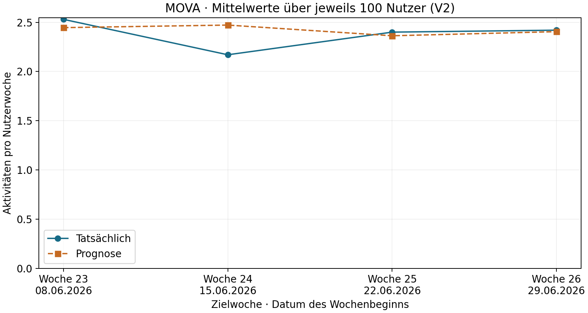
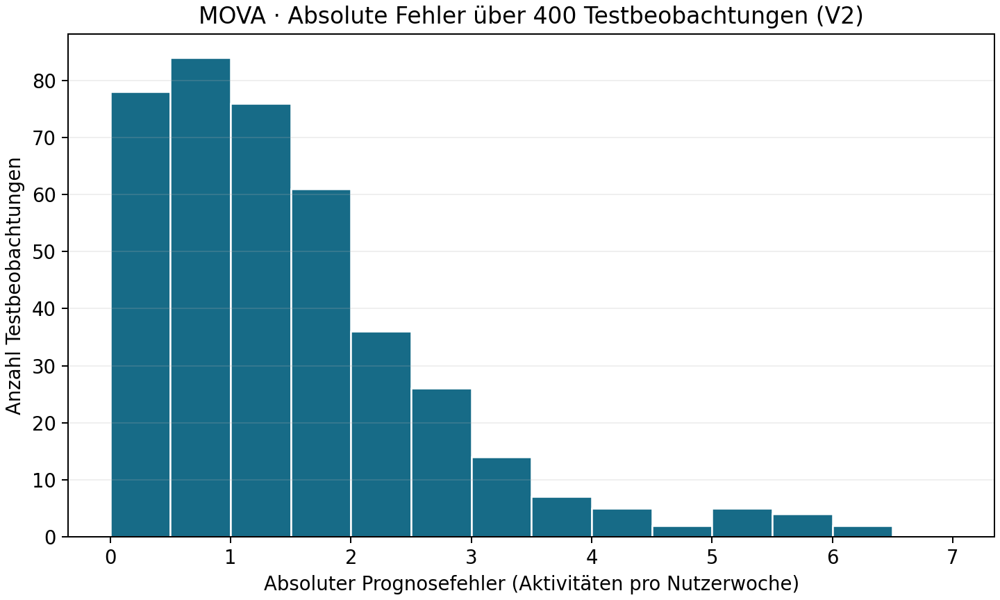
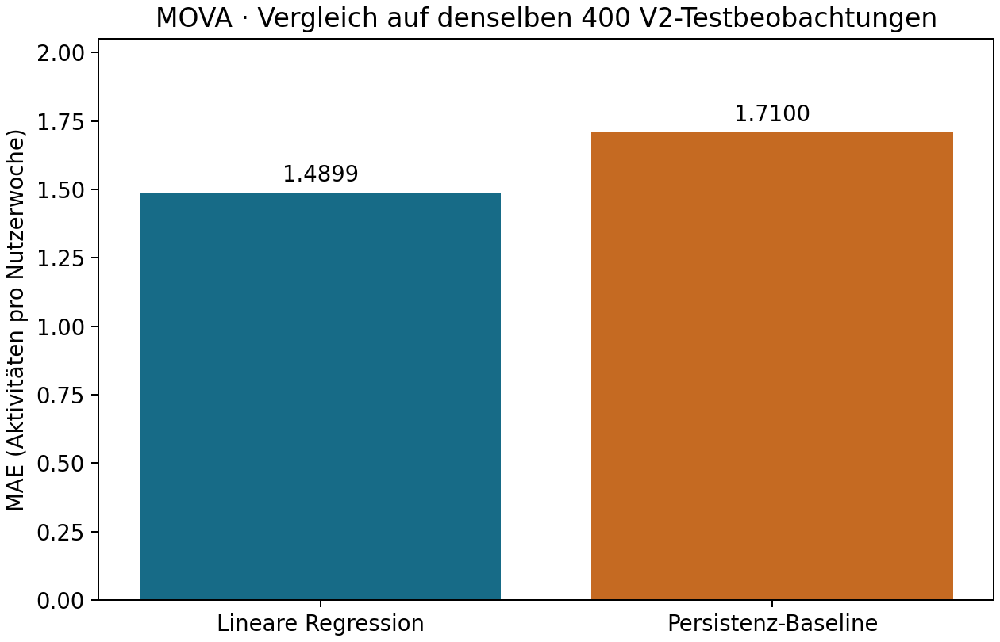
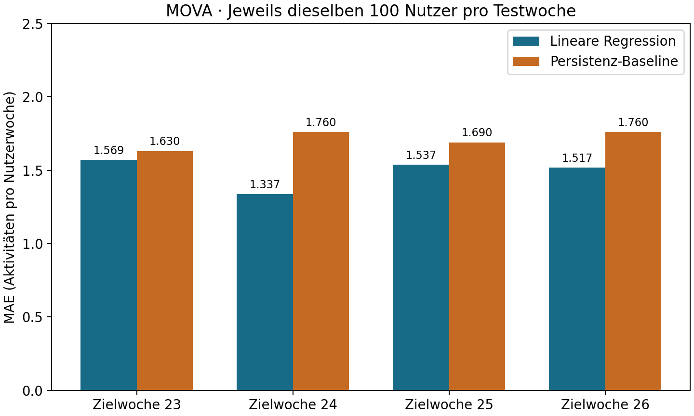

# MOVA – AP 5.4: Training der globalen linearen Regression

Stand: 31.10.2026. Worktree `/workspace/MOVA-AP5`, Branch `ap5-machine-learning`,
Basis `1b26533d2ceea30478577bd519244c245dd3e558`.
CRISP-DM 4.1 Select Modeling Technique, 4.2 Generate Test Design, 4.3 Build Model.

## Ziel und übernommene Planung

Lineare Regression schätzt eine gewichtete Summe der beiden Eingänge plus
Achsenabschnitt. Ordinary Least Squares (OLS) wählt diese Parameter so, dass die
Summe quadrierter Abweichungen zu den Trainingszielen minimal wird.

Ein einziges globales lineares Modell für alle 100 vorhandenen synthetischen
V2-Nutzer prognostiziert die Zahl aller aufgezeichneten sportlichen Aktivitäten
in Woche t+1 aus zwei nach Abschluss von Woche t verfügbaren Merkmalen.
Keine separaten Modelle je Nutzer, Sportart oder K-Means-Segment.
Das globale Modell bündelt die 18 Trainingszeilen pro Nutzer und lernt einen
nachvollziehbaren gemeinsamen Zusammenhang; individuelle Unterschiede bleiben eine
Grenze des Ansatzes. Die zwei einfachen Eingänge beschreiben den jüngsten Zustand
und ein geglättetes kurzfristiges Niveau bei geringem Modellumfang.
K-Means-Zuordnungen wurden aus der gesamten 26-Wochen-Historie abgeleitet und
würden an früheren Prognosezeitpunkten zukünftige Information enthalten. Sie passen
außerdem nicht zum festgelegten Zwei-Merkmals-Basismodell und bleiben ausgeschlossen.
Die chronologische statt zufällige Trennung bildet spätere Zielwochen bekannter
Nutzer ab und verhindert die Verwendung späterer Ziele zum Training früherer
Testprognosen.
Gelesen: regression_feature_concept.md, data_preparation_execution.md,
regression_split_manifest.json und data_dictionary.md. Die getroffenen
Merkmals-, Split- und Prognosezeitpunktentscheidungen bleiben unverändert.

LinearRegression ist ein einfacher nachvollziehbarer OLS-Startansatz mit
Achsenabschnitt. Zähldaten, Nullwochen, Nutzerunterschiede und überlappende
Zeitfenster sind methodische Einschränkungen. Keine optimale Modellfamilie behauptet.

## Tatsächlich geprüfte Trainingsdaten

Ausschließlich `data/processed/regression_train.csv`: 1.800 Zeilen, 100 Nutzer,
18 eindeutige Nutzerwochen je Nutzer; Eingabewochen 4–21, Zielwochen 5–22.
Trainingsziele 02.02.–07.06.2026. Schema, fehlende und nicht endliche Werte,
Nichtnegativität, ganzzahlige Counts, Viertelschritte der Mittelwerte, vollständige
Nutzerwochen, ISO-Kalenderzuordnung und Montag-Sonntag-Intervalle geprüft.
Keine Beanstandungen. Trainings-SHA-256 stimmt mit dem AP-4-Manifest überein:

`e984a547de12aca7d53ce908dd5051992bbd21aa83895a67bcd6fc0b541fb0b8`

AP 4 hatte die zeitliche Konstruktion t−3…t sowie Ziel t+1 unabhängig auditiert;
über den unveränderten Dateihash bleibt dieser geprüfte Stand erhalten. Keine
neue Datenaufbereitung, Imputation, Skalierung oder Merkmalskonstruktion.

Reine Test-Strukturprüfung separat vor Training: Header mit sieben Spalten und
400 Metadatenzeilen, 100 Nutzer, Eingabewochen 22–25 / Zielwochen 23–26;
keine überschneidenden Zielwochen. Dabei wurden ausschließlich user_id, week_index,
week_start und week_end eingelesen, keine Test-X/y-Werte. Das Trainingsskript selbst
öffnet den Testdatensatz überhaupt nicht. Es gibt keine Testvorhersagen,
Testkennzahlen oder vom Test abgeleitete Modellparameter.

## Implementierung und tatsächliche Parameter

`src/modeling_regression_train.py`: Training laden, V2-/Hash-/Datenprüfung,
explizite Auswahl X/y, OLS-Training, unabhängige numerische Parameterprüfung,
Speicherung und erneutes Laden des vertrauenswürdigen lokalen Artefakts.

X in fester Reihenfolge:

1. activities_current_week = c(u,t)
2. avg_activities_last_4_weeks = [c(u,t−3)+c(u,t−2)+c(u,t−1)+c(u,t)]/4

Ausschließlich y: activities_next_week = c(u,t+1).
user_id, week_index, week_start, week_end sind nur Metadaten. Keine Clusterlabels,
Interessen oder Zukunftsinformationen als Regressoren. Nullwochen bleiben enthalten.
Keine Standardisierung: beide Eingänge haben die Einheit Aktivitäten/Woche;
OLS benötigt hier keine zusätzliche Transformation.

LinearRegression: fit_intercept=True, copy_X=True, positive=False, n_jobs=None,
tol=1e-6. tol ist der explizit gespeicherte scikit-learn-Parameter; bei dieser dichten
OLS-Matrix steuert er nicht den Solver wie bei einer sparsamen LSQR-Matrix.
Kein Random Seed erforderlich, kein Variantenvergleich und keine Hyperparameterwahl.
Python 3.12.14, scikit-learn 1.8.0, NumPy 2.3.5, pandas 2.2.3, Joblib 1.5.3;
ein numerischer Thread.

## Tatsächliche Modellparameter und verständliche Erklärung

`ŷ(t+1) = 0,8397931020190079
         + 0,22819007785063997 × activities_current_week
         + 0,42396047869339204 × avg_activities_last_4_weeks`

| Parameter | Tatsächlicher Wert |
| --- | --- |
| Intercept | 0,8397931020190079 |
| activities_current_week | 0,22819007785063997 |
| avg_activities_last_4_weeks | 0,42396047869339204 |

Der Intercept ist der rechnerische Modellwert bei beiden Eingängen gleich null,
also vier aufgezeichneten Nullwochen. Er ist kein garantierter Mindestwert realer
Aktivität und keine pauschale Aussage über Nutzer ohne verlässliche Datenhistorie.

Bei konstantem Vierwochenmittel bedeutet eine zusätzliche aktuelle Aktivität einen
um rund 0,228 höheren Modellwert für die Folgewoche. Bei konstanter aktueller
Aktivitätszahl bedeutet ein um eine Aktivität/Woche höheres Vierwochenmittel einen
um rund 0,424 höheren Modellwert. Das sind bedingte Zusammenhänge im globalen
Modell, keine kausalen Trainingseffekte und keine innerhalb jedes Nutzers bewiesene
Dynamik. Der Vierwochenmittelwert enthält die aktuelle Woche: die Merkmale sind
überlappend und dürfen nicht als voneinander unabhängige Verhaltensfaktoren gelesen werden.

Ändert sich nur die aktuelle Aktivitätszahl um eins und bleiben die drei älteren
Wochen gleich, steigt deshalb auch das Vierwochenmittel um 0,25. Die gemeinsame
rechnerische Änderung beträgt dann 0,2281900779 + 0,25×0,4239604787 ≈0,3341801975.
Dies erläutert nur die Formel und ist keine Testvorhersage oder Gütebewertung.

Lineare Regression liefert reelle Werte statt zwingend ganzzahliger Zählungen.
Keine Rundung oder Begrenzung eingeführt. Negative Prognosen sind eine allgemeine
Grenze der Modellfamilie; ob tatsächlich negative Testprognosen auftreten und ob eine Nachbearbeitung
für MOVA sinnvoll ist, wird erst in AP 5.5 untersucht. Hier wird keine Prognose
verändert, gerundet oder auf null begrenzt.

## Technische Validierung und Reproduzierbarkeit

Die Designmatrix inklusive Intercept hat Rang 3; beide zentrierten Eingänge im
scikit-learn-Modell haben Rang 2. Keine exakte lineare Abhängigkeit.
Koeffizienten und Intercept wurden unabhängig mit numpy.linalg.lstsq auf derselben
Trainingsmatrix geprüft (atol=rtol=1e-12). Dies ist eine technische Solverkontrolle,
keine Evaluation auf bisher ungesehenen Daten. Keine MAE-, RMSE- oder R²-Werte berechnet.

Zwei vollständige Skriptläufe durchgeführt. Modellartefakt, JSON-Metadaten, Koeffiziententabelle und
Konsolenprotokolle in dieser Umgebung bytegleich. Nach vollständigem Eingang des
Auftrags wurden die endgültigen Ausgabepfade verwendet und erneut zwei komplette
Läufe durchgeführt (`work/ap54_complete_run1.json`, `work/ap54_complete_run2.json`). Erneut geladenes Modell hat
dieselben Parameter, Koeffizienten und denselben Intercept. Auf identischen
Trainingsmerkmalen erzeugt es exakt dieselben Vorhersagen wie das frisch trainierte
Modell. Diese Trainingsvorhersagen dienen ausschließlich der Persistenzprüfung;
sie wurden nicht exportiert und nicht zur Gütebewertung verwendet. Abweichende vorhandene
Ausgaben werden nicht überschrieben. Nur vertrauenswürdige lokale Joblib-Dateien
laden; SHA-256 bestätigt Konsistenz, keine Authentizität unbekannter Quellen.

Acht neue automatisierte Tests in `tests/test_modeling_regression_train.py`:
Trainingsrollen/globaler Umfang, unabhängige OLS-Parameter, ungültige Werte,
unzulässige Merkmale und falsche Wochen, Duplikate/Kalenderfehler sowie
reproduzierbares Training ohne Testdateizugriff, Scaler-Fit, predict oder score.
Ausführung: `python -m unittest discover -s tests -p 'test_modeling_regression_train.py' -v`.
Alle acht Tests bestanden. Zusätzlich werden die Vorhersagegleichheit nach Reload und zwischen wiederholten
Fits auf identischen Trainingsmerkmalen sowie die Koeffiziententabelle geprüft.
Dies ist keine erneute Ausführung der übrigen Projekttests.

## Gespeicherte Dateien und Übergabe

- outputs/models/regression_linear.joblib
- outputs/models/regression_linear_metadata.json
- outputs/tables/regression_linear_coefficients.csv
- src/modeling_regression_train.py
- tests/test_modeling_regression_train.py
- documentation/regression_modeling_execution.md

Metadaten enthalten Eingabe- und Manifesthash, X/y-Rollen, Trainingsumfang,
Zeitgrenzen, Modellparameter, Koeffizienten, Intercept, Softwareversionen,
Modellhash und ausdrücklichen Status „Testevaluation noch nicht durchgeführt“.
Alle vor AP 5.4 vorhandenen Daten, Modelle, Skripte und Dokumentationen blieben
unverändert. Die in der vorläufigen Bearbeitung des abgeschnittenen Auftrags
verwendeten Artefaktnamen wurden auf die nun explizit beauftragten Namen umgestellt;
es gibt nur ein aktuelles Regressionsmodell unter outputs/models. Die vorläufige
Metadatenkopie liegt ausschließlich als Arbeitsnachweis unter work.
Kein Commit und kein Pull Request.

AP 5.5: unverändertes Modell auf den 400 zurückgehaltenen Testzeilen evaluieren,
mit Persistenzbaseline auf exakt denselben Zeilen und dem vereinbarten rollierenden
Einwochen-Informationsstand vergleichen. Keine erneute Anpassung an Testziele.
Vier Testwochen bekannter Nutzer belegen keine Generalisierbarkeit auf neue reale
Garmin-Nutzer. Evaluation und Empfehlungen wurden in AP 5.4 nicht durchgeführt.

# AP 5.5 – Evaluation des gespeicherten Regressionsmodells

Stand: 31.10.2026. Ausschließlich Worktree `/workspace/MOVA-AP5`, Branch
`ap5-machine-learning`, Basis `1b26533d2ceea30478577bd519244c245dd3e558`.
CRISP-DM 4.4 Assess Model und 5.1 Evaluate Results (vorbereitend).
Dieser Abschnitt beschreibt die jetzt tatsächlich ausgeführte Testevaluation.
Die AP-5.4-Angaben zur damals noch ausstehenden Evaluation bleiben historische Nachweise.
Der frühere Übergabetext erwähnt einen Baselinevergleich; der aktuelle Auftrag
präzisiert: **Baseline ausdrücklich erst AP 5.6**, hier weder implementiert noch berechnet.

## Ziel, gespeichertes Modell und Evaluationsdesign

Die mathematisch unveränderten Vorhersagen des globalen Modells auf zurückgehaltenen
V2-Testbeobachtungen bewerten. `src/modeling_regression_evaluate.py` lädt ausschließlich
`outputs/models/regression_linear.joblib` aus vertrauenswürdiger lokaler Projektquelle.
Joblib-Dateien unbekannter Herkunft dürfen nicht geladen werden; SHA-256 sichert
Konsistenz, keine Herkunftsauthentizität. Modellhash und Metadatenhash stehen in den
Evaluationsergebnissen. Koeffiziententabelle, Modell und Metadaten wurden abgeglichen:
Intercept 0,8397931020190079, Koeffizienten 0,22819007785063997 und
0,42396047869339204 in der Reihenfolge activities_current_week,
avg_activities_last_4_weeks. Keine Skalierung oder Parameteränderung.
Software weiterhin Python 3.12.14, scikit-learn 1.8.0, NumPy 2.3.5,
pandas 2.2.3, Matplotlib 3.10.8; ein numerischer Thread.

Testquelle `data/processed/regression_test.csv`: 400 Zeilen, dieselben 100 Nutzer
wie beim Training, vier Beobachtungen je Nutzer; Eingabewochen 22–25,
Zielwochen 23–26 (08.06.–05.07.2026). Test-SHA-256:
`b0c11c94209323c01f098042261349a3ed506c408af5303a4ac9d5e84715c1fa`.
Trainingsziele enden in Woche 22; keine Überschneidung mit Testzielen ab Woche 23.

Rollierende Einwochenprognosen nach Abschluss von Woche t, kein gleichzeitiger
Vierwochen-Ausblick von einem einzigen Stichtag. Beobachtete frühere Testwochen
dürfen später zu X werden, sobald abgeschlossen. Das Modell bleibt unverändert.
Jede der 400 Zeilen wurde gegen die hashgeprüfte Wochenquelle kontrolliert:
aktuelle Woche t und Mittel aus t−3…t als Eingänge, ausschließlich t+1 als Ziel.
Kein fit, fit_predict oder fit_transform im Evaluationsablauf. Keine Zielwerte
werden an die Modellvorhersage übergeben. Metadaten, Ziel, Clusterlabels und
Interessen sind keine Modelleingänge. Keine Neuschätzung anhand des Tests.

## Tatsächliche Gesamtkennzahlen

Fehlerdefinition: Prognose minus tatsächlicher Zielwert. Positiv bedeutet
Überschätzung, negativ Unterschätzung. Absolute Fehler sind Beträge dieser Differenz.
MAE ist der Mittelwert aller 400 absoluten Fehler; RMSE ist die Quadratwurzel des
mittleren quadrierten Fehlers und gewichtet große Abweichungen stärker.
Beide haben die Einheit Aktivitäten pro Nutzerwoche. Keine Rundung oder Begrenzung
vor Kennzahlenberechnung; Exporte mit 17 signifikanten Stellen.

| Kennzahl | Tatsächlicher Wert |
| --- | --- |
| MAE | 1.48987705752 |
| RMSE | 1.90853765454 |
| Mittlerer vorzeichenbehafteter Fehler | 0.0413829062741 |
| Durchschnitt tatsächlicher Aktivitäten | 2.38 |
| Durchschnitt prognostizierter Aktivitäten | 2.42138290627 |
| Kleinster Prognosewert | 0.839793102019 |
| Größter Prognosewert | 7.14931842811 |
| Kleinster tatsächlicher Zielwert | 0 |
| Größter tatsächlicher Zielwert | 10 |
| Negative Prognosen (Anzahl) | 0 |
| Negative Prognosen (Anteil) | 0 |

Der MAE von rund **1,489877** bedeutet: Über alle Test-Nutzerwochen weicht die
Prognose im Mittel um rund 1,49 aufgezeichnete Aktivitäten vom tatsächlichen Wert ab.
Dies ist keine Prozentangabe und noch keine abschließende Qualitätsbewertung.
Der mittlere vorzeichenbehaftete Fehler von +0,041383 zeigt eine leichte gepoolte
Überschätzung; positive und negative Einzelfehler können sich dabei aufheben.
Dass die Durchschnittsprognose nahe am tatsächlichen Mittel liegt, bedeutet daher
keine entsprechend genaue Einzelprognose. Keine negativen Prognosen beobachtet
(0 %); alle Vorhersagen bleiben unverändert, keine Nachbearbeitung vorgenommen.

### Verteilung der absoluten Fehler

Quantile linear interpoliert, deskriptiv über die 400 Nutzerwochen:

| Quantil | Absoluter Fehler |
| --- | --- |
| 0 % | 0.005684418 |
| 25 % | 0.693430393 |
| 50 % | 1.233754405 |
| 75 % | 2.005684418 |
| 90 % | 2.869516724 |
| 95 % | 3.766681936 |
| 99 % | 5.666574727 |
| 100 % | 6.312285941 |

39 Fehler sind strikt größer als drei Aktivitäten, 11 strikt größer als fünf. Diese Schwellen sind ausschließlich
beschreibende Hinweise, keine vorab vereinbarten fachlichen Akzeptanzgrenzen.
Der größte Fehler beträgt rund 6,312286 Aktivitäten; einzelne erhebliche Abweichungen
sind trotz kleiner gepoolter mittlerer Verzerrung vorhanden. Kein Ausreißer gelöscht.

## Tatsächliche Ergebnisse je Zielwoche

| Zielwoche | Beginn | Beobachtungen | Tatsächlich Mittel | Prognose Mittel | MAE | RMSE |
| --- | --- | --- | --- | --- | --- | --- |
| 23 | 2026-06-08 | 100 | 2.530000 | 2.445792 | 1.568914 | 2.001869 |
| 24 | 2026-06-15 | 100 | 2.170000 | 2.471716 | 1.336618 | 1.733318 |
| 25 | 2026-06-22 | 100 | 2.400000 | 2.363070 | 1.536849 | 1.945598 |
| 26 | 2026-06-29 | 100 | 2.420000 | 2.404954 | 1.517126 | 1.942380 |

Woche 23 hat den höchsten MAE und RMSE, Woche 24 die niedrigsten Werte.
Die MAE-Spanne beträgt rund 0,232296 Aktivitäten. Zugleich liegt die durchschnittliche
Prognose in Woche 24 um rund 0,301716 oberhalb des tatsächlichen Mittels.
Vier Wochen erlauben keine belastbare Aussage über die Ursache oder dauerhafte
zeitliche Veränderungen der Qualität. Keine statistische Signifikanz behauptet.
Der Gesamt-MAE entspricht dem nach Fallzahl gewichteten Wochen-MAE; Gesamt-RMSE
ist die Wurzel aus dem gewichteten Mittel der quadrierten Wochen-RMSEs.

## Tatsächliche Nullwochen

| Zielgruppe | Fallzahl | MAE |
| --- | --- | --- |
| Tatsächlicher Zielwert 0 | 92 | 1.878292396 |
| Mindestens eine tatsächliche Aktivität | 308 | 1.373856891 |

Die tatsächlichen Nullwochen haben hier einen höheren absoluten Fehler.
Positive Prognosen bei tatsächlichem Ziel null sind Prognosefehler, keine allein
hierdurch belegten Implementierungsfehler. Das Modell bildet ein bedingtes mittleres
Niveau ab und erkennt keine zukünftige Trainingspause sicher. Kein Nullziel entfernt,
keine Prognose nachträglich auf null gesetzt.

## Drei echte Ergebnisse aus dem synthetischen V2-Testdatensatz

Auswahl nach unterschiedlicher absoluter Fehlergröße: kleinster Fehler, zentrale
Beobachtung der sortierten Fehler und größter Fehler. Das ist eine illustrative,
gezielte Auswahl; die Gesamtbewertung verwendet immer alle 400 Zeilen.

| Nutzer | Eingabewoche | Zielwoche | Tatsächliche Aktivitäten → Modellprognose → absoluter Fehler |
| --- | --- | --- | --- |
| U044 | 24 | 25 | 2 → 2.005684418 → 0.005684418 |
| U027 | 25 | 26 | 1 → 2.233874496 → 1.233874496 |
| U036 | 25 | 26 | 8 → 1.687714059 → 6.312285941 |

Insbesondere wird U036 in Zielwoche 26 deutlich unterschätzt: tatsächliche acht
Aktivitäten gegenüber etwa 1,69 prognostizierten. Dies zeigt eine Grenze des
kurzfristigen globalen Ansatzes, aber keine belegte Ursache für die Abweichung.

## Visualisierungen

Zielwochen 23–26 mit tatsächlichem Kalender-Wochenbeginn; beide Reihen sind
Durchschnittswerte über jeweils 100 Nutzer. Die Nähe der Mittelwerte darf nicht
mit der Genauigkeit einzelner Nutzerprognosen verwechselt werden.

Histogramm aller 400 absoluten Fehler, feste Klassenbreite 0,5 Aktivitäten,
Häufigkeit auf der y-Achse. Die Verteilung hat einen rechten Ausläufer bis über
sechs Aktivitäten. Alle Werte enthalten, keine Rundung vor Einteilung.
Beide Grafiken tatsächlich erzeugt und visuell auf Beschriftungen/Einheiten geprüft.

## Validierungen, Tests und Reproduzierbarkeit

Neue Tests: `tests/test_modeling_regression_evaluate.py`, sieben Testfälle:

1. Vollständige Evaluation mit explizit gesperrtem LinearRegression.fit sowie
   StandardScaler.fit und fit_transform; 400 Nutzerwochen reproduziert.
2. Zielvariable oder Metadaten als Eingänge sowie falsche Feature-Reihenfolge abgelehnt.
3. Fehlende/unendliche/negative/nicht ganzzahlige Zielwerte, falsche Wochen und
   doppelte Nutzerwochen erkannt.
4. Verfälschtes Vierwochenfenster gegen die Wochenquelle erkannt.
5. Fehler, MAE, RMSE und mittlerer Fehler unabhängig aus exportierter Prognosetabelle
   nachgerechnet; Sortierung geprüft.
6. Wochenkennzahlen und Null-/Positivgruppen korrekt zum Gesamtergebnis aggregiert.
7. Unveränderte Modellvorhersagen und Koeffizienten/Metadaten, keine Baseline gerechnet.

`python -m unittest discover -s tests -p 'test_modeling_regression_evaluate.py' -v`:
**sieben Tests bestanden**. Nur diese neuen Tests ausgeführt; ältere Trainingstests
bewusst nicht erneut gestartet, da AP 5.5 kein Training erlaubt.

`python src/modeling_regression_evaluate.py` zweimal vollständig ausgeführt.
Prognose-CSV, Wochen-CSV, Kennzahlen-JSON und beide PNGs waren **bytegleich**;
auch Konsolenprotokolle identisch (`work/ap55_run1.log`, `work/ap55_run2.log`).
Der zweite Lauf berechnet alle Ausgaben neu und akzeptiert vorhandene Dateien
nur bei vollständiger Bytegleichheit. Reproduzierbarkeit gilt für diese dokumentierte
Umgebung; keine plattformübergreifende Bytegarantie. Alle 400 Prognosen endlich,
keine fehlenden Zuordnungen, exakt zwei Eingänge in korrekter Reihenfolge.

Alle vor AP 5.5 vorhandenen Projektdateien wurden vor/nach per SHA-256 verglichen:
unverändert außer der autorisierten Ergänzung dieses Berichts. Bisheriger Bericht
bleibt bytegleich als Präfix erhalten. Insbesondere Modell, Koeffizienten,
Trainingsmetadaten, Testdatei und alle K-Means-Artefakte unverändert. Die AP-5.4-
Metadaten behalten ihren historischen Trainingsstatus; die tatsächlich erfolgte
Evaluation wird ausschließlich im neuen Evaluations-JSON dokumentiert.

## Grenzen und Empfehlung für AP 5.6

Synthetische Daten, nur vier Testwochen, dieselben 100 Nutzer wie im Training.
Die 400 Beobachtungen sind wegen wiederholter Nutzer und überlappender Historien
zeitlich abhängig. Keine 400 unabhängigen Validierungsfälle; keine Generalisierung
auf unbekannte oder reale Garmin-Nutzer belegt. Die begrenzte Historie, gemeinsame
Koeffizienten und geglätteten Eingänge können individuelle Niveauwechsel oder
Pausen nur eingeschränkt abbilden. Die Evaluation zeigt diese Grenzen deskriptiv,
beweist aber keine Ursachen oder kausalen Effekte.

**Eine Bewertung gegenüber einer einfachen Baseline fehlt noch.** Daher wird die
Prognosequalität hier nicht abschließend als gut oder schlecht eingeordnet.
Empfehlung AP 5.6: die bereits geplante Persistenzbaseline auf exakt denselben
400 Testzeilen, Zielwochen und Informationsständen vergleichen. In AP 5.5 ist
sie weder implementiert noch evaluiert. Keine konkreten MOVA-Empfehlungen berechnet.

Der Test ist nun eingesehen. Keine unkontrollierte Optimierung darauf durchführen.
Falls der spätere Vergleich Anpassungsbedarf nahelegt, diesen zunächst als Erkenntnis
dokumentieren und Varianten nur über vorab geplante zeitliche Validierung innerhalb
der Trainingsperiode entwickeln; für eine neue abschließende Bewertung einen
unberührten späteren Zeitraum bzw. unabhängige Daten reservieren. Keine neue
CRISP-DM-Iteration oder Modellverbesserung behauptet. Kein Commit und kein Pull Request.

# AP 5.6 – Vergleich mit der Persistenz-Baseline

Stand: 31.10.2026. CRISP-DM 4.4 Assess Model und 5.1 Evaluate Results.
Worktree `/workspace/MOVA-AP5`, Branch `ap5-machine-learning`, Basis
`1b26533d2ceea30478577bd519244c245dd3e558` unverändert.

## Ziel und tatsächlich ausgeführtes Verfahren

Den Zusatznutzen der gespeicherten Regressionsprognosen gegenüber der einfachen
Regel `baseline_prediction = activities_current_week` auf identischen Testfällen
untersuchen. Persistenz nimmt an, dass die jüngste Wochenhäufigkeit in der nächsten
Woche bestehen bleibt. Sie ist verständlich, ohne Training verfügbar und verwendet
nur zum Prognosezeitpunkt bekannte Information. Kein weiterer Baselineansatz.

Neues Skript `src/modeling_regression_baseline.py`: Testdatei und vorhandene
AP-5.5-Prognosen laden, vollständigen äußeren 1:1-Join über user_id und week_index
prüfen, Ziele, beide Eingangsmerkmale und Datumsmetadaten exakt vergleichen.
Alle 400 Beobachtungen, 100 Nutzer und vier Wochen je Nutzer sind erhalten;
Ergebnistabelle nach user_id und week_index sortiert. CSVs wurden mit round-trip-
Float-Lesen eingelesen, gerechnet wurde mit den ungerundeten gespeicherten Werten.
Die V2-Testdatei ist per Split-Manifest und AP-5.5-Metriken hashbestätigt.
Alle verwendeten Quellen samt SHA-256 stehen im neuen Kennzahlen-JSON.

Kein gespeichertes Modell geladen, kein predict, fit oder Hyperparametervergleich
nötig: Regressionsprognosen unverändert aus AP 5.5 übernommen. Regression war nur
auf Trainingsdaten gefittet worden; Testziele wurden nicht zur Modellanpassung
verwendet. Beide Verfahren haben denselben rollierenden Einwochen-Informationsstand.
Frühere abgeschlossene Testwochen dürfen spätere Eingänge liefern; das ist kein
Leakage. Modell und alle früheren Ergebnisdateien bleiben unverändert.

## Tatsächliches Gesamtergebnis

MAE/RMSE und vorzeichenbehafteter Fehler haben die Einheit Aktivitäten pro Nutzerwoche.
Vorzeichenfehler = Prognose minus tatsächlichem Zielwert. Keine Rundung/Begrenzung.

| Kennzahl | Regression | Persistenz-Baseline |
| --- | --- | --- |
| MAE | 1.489877057523 | 1.710000000000 |
| RMSE | 1.908537654537 | 2.310844001658 |
| Mittlerer vorzeichenbehafteter Fehler | 0.041382906274 | 0.020000000000 |
| Kleinster absoluter Fehler | 0.005684418426 | 0.000000000000 |
| Größter absoluter Fehler | 6.312285940594 | 10.000000000000 |

Absolute MAE-Verbesserung = Baseline-MAE − Regressions-MAE = **0.220122942477**.
Relative MAE-Verbesserung = Differenz / Baseline-MAE × 100 = **12.872686695 %**.

Die Regression hat damit im untersuchten Test einen niedrigeren durchschnittlichen
absoluten Fehler und niedrigeren RMSE. Der Baseline-MAE ist hier nicht null.
Allgemein wird bei Baseline-MAE=0 die relative Verbesserung als JSON null
(nicht definiert) gespeichert, die absolute Differenz bleibt erhalten. Negative
Verbesserungswerte bedeuten ausdrücklich eine Verschlechterung der Regression.

Die mittlere vorzeichenbehaftete Abweichung der Regression ist etwas positiver als
bei Persistenz. Niedrigerer MAE/RMSE bedeutet folglich nicht automatisch eine
kleinere gepoolte Verzerrung. Beide Vorzeichenmittel können gegenläufige Einzelfehler
verdecken. Die AP-5.5-Regressionswerte wurden numerisch abgeglichen (atol=rtol=1e-12).

## Ergebnisse je Zielwoche

| Zielwoche | n | MAE Regression | MAE Baseline | Absolute Verbesserung | Relative Verbesserung |
| --- | --- | --- | --- | --- | --- |
| 23 | 100 | 1.568914442 | 1.630000000 | 0.061085558 | 3.747580 % |
| 24 | 100 | 1.336618421 | 1.760000000 | 0.423381579 | 24.055772 % |
| 25 | 100 | 1.536849076 | 1.690000000 | 0.153150924 | 9.062185 % |
| 26 | 100 | 1.517126291 | 1.760000000 | 0.242873709 | 13.799643 % |

Die Regression hat in allen vier Wochen einen niedrigeren MAE und auch einen
niedrigeren RMSE. Der MAE-Vorteil schwankt jedoch deutlich: rund 3,75 % in Woche 23
bis 24,06 % in Woche 24. Vier Wochen reichen nicht, um eine dauerhafte Verbesserung
in gleicher Größenordnung anzunehmen. Keine Signifikanz oder Unsicherheitsintervalle
behauptet; die Wochen und wiederholten Nutzerbeobachtungen sind nicht unabhängig.

## Nullwochen und Nicht-Nullwochen

Gruppenbildung ausschließlich nach tatsächlich beobachtetem Ziel, zur nachträglichen
Diagnose. Diese Kenntnis steht einer Vorhersageregel zum Prognosezeitpunkt nicht zur
Verfügung; daraus wird keine datenabhängige Auswahl zwischen Verfahren abgeleitet.

| Tatsächliches Ziel | n | MAE Regression | MAE Baseline | Absolute Verbesserung | Relative Verbesserung |
| --- | --- | --- | --- | --- | --- |
| 0 | 92 | 1.878292396 | 1.380434783 | -0.497857613 | -36.065276 % |
| größer 0 | 308 | 1.373856891 | 1.808441558 | 0.434584667 | 24.030894 % |

**Bei tatsächlichen Nullwochen ist die Regression nach MAE schlechter:** rund
36,07 % höherer MAE als Persistenz. Der positive Intercept und das geglättete Niveau
können nach niedrigen/Null-Eingängen positive Prognosen erzeugen; Persistenz kann
bei aktueller Null und folgender Null exakt treffen. Das ist eine plausible
mathematische Erklärung einzelner Fälle, kein Nachweis realer Pausenursachen.
Die Regression hat in dieser Gruppe dennoch den etwas niedrigeren RMSE
(2,031267 gegenüber 2,149317): einzelne große Persistenzfehler werden stärker
reduziert, während der durchschnittliche absolute Fehler größer ist. Dieser
Zielkonflikt zwischen MAE und RMSE wird nicht als durchgehende Überlegenheit ausgelegt.
Bei den 308 positiven Zielen verbessert die Regression den MAE um rund 24,03 %.

## Einzelprognosen und auffällige Unterschiede

absolute_error_difference = baseline_absolute_error − regression_absolute_error.
Positive Werte sprechen für Regression, negative für Persistenz, null für gleichen
absoluten Fehler. Gezählt wird exakte Gleichheit unveränderter Float-Werte,
keine nachträglich gewählte Toleranz oder Rundung.

| Ergebnis pro Beobachtung | Anzahl | Anteil |
| --- | --- | --- |
| Regression besser | 229 | 57.25 % |
| Baseline besser | 171 | 42.75 % |
| Gleich gut | 0 | 0.00 % |

Die mittlere absolute Fehlerdifferenz ist 0.220122942477; sie entspricht bis auf numerische Rundung der Differenz der MAEs.

Drei tatsächliche V2-Testfälle, bewusst zur Illustration unterschiedlicher Fälle
gewählt, kein repräsentativer Teildatensatz. Alle Gesamtkennzahlen verwenden 400 Zeilen.

| Nutzer | Zielwoche | Tatsächlich → Regression → Baseline | Absoluter Fehler Regression / Baseline | Differenz |
| --- | --- | --- | --- | --- |
| U019 | 25 | 0 → 5.665456753 → 10 | 5.665456753 / 10 | 4.334543247 |
| U090 | 23 | 10 → 6.937338189 → 10 | 3.062661811 / 0 | -3.062661811 |
| U004 | 23 | 2 → 1.720133736 → 2 | 0.279866264 / 0 | -0.279866264 |

U019/Zielwoche 25 zeigt den größten Vorteil der Regression: Nach zehn aktuellen
Aktivitäten folgen tatsächlich null. Persistenz überschätzt um zehn, Regression
um rund 5,67. U090/Zielwoche 23 zeigt den größten Nachteil: Die tatsächliche hohe
Zahl zehn bleibt konstant, Persistenz trifft exakt, Regression unterschätzt um
rund 3,06. U004 zeigt einen moderaten Nachteil trotz exakter Persistenz. Die
Regression glättet extreme Eingaben; je tatsächlichem Verlauf kann das helfen oder
schaden. Keine Kausalität und keine universelle Nutzerregel daraus abgeleitet.

## Visualisierungen

Balkendiagramm beider MAEs auf denselben 400 Nutzerwochen; Achse beginnt bei null,
Einheit klar angegeben und tatsächliche Werte beschriftet.

Vier Zielwochen mit jeweils 100 identischen Nutzern, paarige Balken und konsistente
Farben. Beide Grafiken tatsächlich erzeugt und visuell auf Beschriftung und
Lesbarkeit geprüft. Keine Fehlerbalken, da keine inferenzstatistische Analyse ausgeführt.

## Technische Validierung, Tests und Reproduzierbarkeit

Neue Tests `tests/test_modeling_regression_baseline.py` (sieben Testfälle):
Vergleich mit gesperrtem fit/predict/Joblib-Load; schlüsselbasierter Join trotz
umgekehrter Zeilenreihenfolge; fehlende/doppelte/geänderte Schlüssel abgelehnt;
geänderte Ziele oder Eingänge abgelehnt; MAE/RMSE/Vorzeichenfehler unabhängig aus
Export nachgerechnet; positive/negative Verbesserungswerte und Nullnenner geprüft;
Fallzahlen und Gruppenaggregation kontrolliert. Fehlerfälle nur auf Speicherkopien.

`python -m unittest discover -s tests -p 'test_modeling_regression_baseline.py' -v`:
**sieben neue Tests bestanden**. Ältere Trainingstests nicht erneut ausgeführt.
Baseline ist exakt aktuelle Wochenaktivitätszahl. Alle 400 Schlüssel eindeutig,
vier Zeilen je Nutzer; Wochenumfänge 4×100, Gruppen 92+308, Einzelergebnisse
229+171+0=400. MAE/RMSE der Regression entsprechen AP 5.5; alle ursprünglichen
Regressionsprognosen sind unverändert.

`python src/modeling_regression_baseline.py` zweimal vollständig ausgeführt.
Vergleichs-CSV, Kennzahlen-JSON und beide PNGs **bytegleich**, ebenso die
Konsolenprotokolle (`work/ap56_run1.json`, `work/ap56_run2.json`). Vorhandene
abweichende Ausgaben werden nicht überschrieben. Numerische Genauigkeit im Export:
17 signifikante Stellen, JSON ungerundete Float-Werte; feste PNG-Metadaten.
Gilt für diese Umgebung (Python 3.12.14, scikit-learn 1.8.0, NumPy 2.3.5,
pandas 2.2.3, Matplotlib 3.10.8), keine plattformübergreifende Bytegarantie.

Alle vor AP 5.6 vorhandenen Dateien wurden vor/nach per SHA-256 verglichen:
unverändert außer der autorisierten Ergänzung dieses Berichts. Der bisherige Text
bleibt bytegleich als Präfix erhalten. Keine Modell-, Koeffizienten-, Daten- oder
AP-5.5-Ergebnisänderung. Kein Commit und kein Pull Request.

## Fachliche Bedeutung und offene gemeinsame Bewertung

Der Vergleich zeigt auf diesem synthetischen Test einen messbaren Zusatznutzen
nach Gesamt-MAE und RMSE gegenüber genau dieser Persistenzregel. Er rechtfertigt,
die Regression als vorläufigen Baustein weiter fachlich zu bewerten; er belegt
keine ausreichende Genauigkeit für konkrete MOVA-Empfehlungen. Der Nachteil bei
Nullzielen und die großen verbleibenden Einzelabweichungen sind ausdrücklich
Teil der Abnahmeentscheidung. Eine automatische Entscheidung nach künftigem
Null-/Nichtnullziel wäre unzulässig, weil dieses Ziel dann noch unbekannt ist.

Grenzen: nur vier Testwochen, dieselben 100 Nutzer wie im Training, synthetische
Daten, zeitlich abhängige und überlappende Nutzerbeobachtungen. Keine gesicherte
Übertragbarkeit auf unbekannte oder reale Garmin-Nutzer und keine dauerhafte
12,87-%-Verbesserung behauptet. Keine statistische Signifikanz geprüft.

Empfehlung für den nächsten Schritt: gemeinsam festlegen, welchen Fehler MOVA
fachlich toleriert und welche Rolle das Modell trotz des Nullwochen-Nachteils
übernehmen darf. Modell nicht anhand dieses Tests verändern. Ein möglicher neuer
Versuch müsste später als kontrollierte CRISP-DM-Iteration mit zeitlicher Validierung
innerhalb der Trainingsdaten und einer unberührten abschließenden Bewertungsbasis
geplant werden; hier wurde keine solche Iteration durchgeführt. Keine weiteren
Baselines, neuen Merkmale, Trainingsläufe oder konkreten Empfehlungen erstellt.
